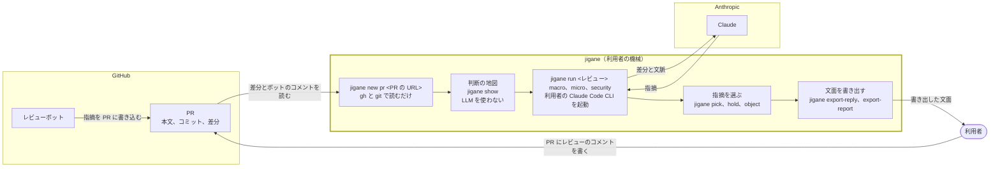
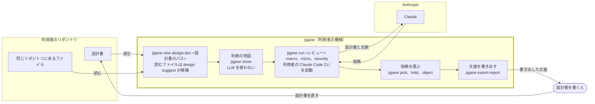

# jigane（地鉄）

[](https://github.com/kokiTakashiki/jigane/actions/workflows/ci.yml)

GitHub の Pull Request（以降、PR）と設計書のレビューを補助する、Claude Code CLI を使った道具です。判断の地図として、コードの変更のどこに人の判断が要るかを LLM を使わずに作成します。その判断の地図を利用して、方針、実装、セキュリティの三つを LLM で解析します。実装とセキュリティの指摘は、別の起動の役が反証を試みて確かめます。機能はすべて CLI として作っています。

名前の地鉄は、日本刀の刀身の鋼の肌を指します。鑑賞と鑑定では、作られた時代や流派を見極める見どころとされます。

## 想定する使い方

jigane は、利用者の手元の機械で動きます。想定する使い方は、GitHub の PR のレビューと、設計書のレビューの二つです。どちらも、jigane が出した指摘から利用者が選び、文面を書き出すところまでを受け持ちます。PR へのコメントと設計書の直しは利用者が行い、jigane は GitHub へ書き込みません。

### GitHub の PR のレビュー

jigane が PR の差分とボットのコメントを読み、判断の地図を作成します。利用者の Claude Code を通じて指摘を生成します。jigane では利用者の選んだ指摘を文面として書き出すところまでサポートします。



詳しい流れは「[GitHub の PR のレビュー](docs/usage.md#github-の-pr-のレビュー)」の節にあります。

### 設計書のレビュー

jigane が設計書と同じリポジトリのファイルを読み、判断の地図を作成します。利用者の Claude Code を通じて指摘を生成します。jigane では利用者の選んだ指摘を文面として書き出すところまでサポートします。



詳しい流れは「[設計書のレビュー](docs/usage.md#設計書のレビュー)」の節にあります。

## 導入

次の二つの手順で使い始めます。

1. `uv tool install jigane` か `pipx install jigane` で入れます。

   ```bash
   uv tool install jigane
   ```

   ```bash
   pipx install jigane
   ```

2. `jigane languages fetch` で tree-sitter の文法を取得します。文法は、入れるだけでは揃わないので、この手順で取得します。照合と、照合できる platform は「[文法の取得](docs/data-destinations.md#文法の取得)」の節にあります。

   ```bash
   jigane languages fetch
   ```

   名前を並べると、その言語だけを取得します（例 `jigane languages fetch python swift`）。何も書かなければ、組み込みと有効にした追加の言語のすべてを取得します。

   取得の前に、利用規約とプライバシーポリシーの場所（`TERMS.ja.md`、`PRIVACY.ja.md` と英語版）を示し、同意を求めます。入れた版のリリースなら、その版のタグの文書を、それ以外は main の文書を示します。y と答えたときだけ文法を取得します。標準入力が端末でないとき（CI やスクリプト）は、`--accept-terms` を付けたときだけ取得します。

   ```bash
   jigane languages fetch --accept-terms
   ```

前提は次のとおりです。

- Claude Code CLI 2.1.308 以降にログイン済みであること。jigane は Claude Code を起動する前に `claude --version` で版を確かめ、2.1.308 より古いときと版を読み取れないときは起動せずに止まります
- Windows では、Claude Code の公式のインストーラで入れた claude.exe があること。npm で入れた claude.cmd は cmd.exe を通って起動され、JSON の引数を安全に渡せないため、jigane は起動しません。手順は <https://code.claude.com/docs/en/setup#install-on-native-windows> にあります
- git が使えること
- PR のレビュー（PR の URL を取る）を使うなら、GitHub CLI（gh）にログイン済みであること。呼ぶコマンドは「[jigane が呼ぶ gh のコマンド](docs/data-destinations.md#jigane-が呼ぶ-gh-のコマンド)」の節に挙げます
- セキュリティのスキルで MCP サーバを使うなら（任意です）、データの置き場（既定は `~/.local/share/jigane`）の `mcp.json` に、使う MCP サーバの起動の設定を利用者が書くこと。MCP を使わない既定の実行には、`mcp.json` は要りません

## 対応する言語

判断の地図と flaky の検査は、tree-sitter で読む次の四言語に対応します。

| 言語 | 拡張子 |
|---|---|
| Python | `.py` |
| Java | `.java` |
| Swift | `.swift` |
| C# | `.cs`（`Foo.xaml.cs` は、対応する `Foo.xaml` のイベントの結線も読みます） |

方針の資料の図は、言語ごとに対応が違います。Python はすべての図に対応します。Java と C# は、副コマンドの引数と、保存物の書く側と読む側の二つに対応しません。Swift は、副コマンドの引数に対応せず、保存物の書く側と読む側は `UserDefaults` 、Codable の JSON（`JSONEncoder` の `encode` と `JSONDecoder` の `decode`）、Keychain（`SecItem` の関数）に対応します。`jigane languages list` が、言語ごとの対応する図と対応外の図を示します。

ほかの言語のファイルも、レビューから外しません。判断の地図は、構文を読まずに変更の行をロジックの変更として扱い、確認が要る区間として示します。flaky の検査は、ほかの言語のファイルを調べません。方針、実装、セキュリティの解析は、言語でファイルを絞り込みません。ほかの言語は「[言語を追加する](docs/adding-languages.md#言語を追加する)」の節の手順で足せます。

範囲のファイルに、解析しない言語のソースが含まれるときは、`new`、`estimate`、`run` が案内を出します。案内の内容は「[解析しない言語の案内](docs/commands.md#解析しない言語の案内)」の節にあります。構文エラーなど、読めない記述がある場合も、「[読めない記述の案内](docs/commands.md#読めない記述の案内)」を出します。

## 使い方

### 機能

次の機能がそろっています。

| 機能 | できること |
| --- | --- |
| 入力 | PR の URL を取る PR のレビュー、git の範囲を取る範囲のレビュー、ファイル群を取るファイルのレビュー、設計書を取る設計書のレビューの四種類です。PR のレビューは、変更前と変更後のツリー、背景（本文が参照する文書、同じファイルに触れた過去の PR、CODEOWNERS）、レビューボットのコメントを集めます |
| 判断の地図 | Python、Java、Swift、C# の四言語を tree-sitter で読み、変更を種類と判断の要否（重要、確認、機械）に分けます。段は読む順番を示すだけで、どの段の変更も人が読むものです。権限の差し替えや認証の除去のように振る舞いを変える本体の変更は、機械的に重い段へ上げられないことがあります。静的検査の結果（SARIF）を渡すと、指摘の付いた変更を「重要」に上げます |
| flaky の排除 | 四言語のテストの flaky の型を tree-sitter の query で検出し、直接の型をゲート違反、兆候の型を警告にします。読めない記述（構文エラーなど）も警告として結果に残ります |
| スキル | 方針（M0〜M7、P1〜P4）、実装（D1〜D10、P1〜P4、T1〜T4）、セキュリティ（MASVS と ASVS）の三つの群です。セキュリティの群は、利用者が登録した MCP を `--mcps` で選んで使えます。指摘は選別して、実装はテーマに束ねます |
| 仕上げ | 指摘の選別（pick、unpick、hold、unhold、object、unobject）と、テンプレートによる返信とレポートの書き出しです |

三つの群の中身は「[方針、実装、セキュリティのレビュー](docs/reviews.md#方針実装セキュリティのレビュー)」の節に、SARIF の渡し方は「[静的検査の結果（SARIF）を取り込む](docs/sarif.md#静的検査の結果sarifを取り込む)」の節に書いています。静的検査は CI で併用してください。CodeQL や Semgrep は例で、これらが検出する内容を jigane は保証しません。

### コマンド

レビューは、PR のレビュー、範囲のレビュー、ファイルのレビュー、設計書のレビューの四種類です。レビューの識別子は、PR のレビューが `<owner>/<repo>#<番号>`、範囲のレビューが `<owner>/<repo>@<名前>`、ファイルのレビューが `<owner>/<repo>:<名前>`、設計書のレビューが `<owner>/<repo>+<名前>` で、`new` の出力に示します。識別子は、呼び出した場所のリポジトリのレビューの中で名前が一つに決まるときに限り、名前だけ（例 `payment`）でも指せます。0 件や 2 件以上（同じ名前の範囲とファイルのレビューなど）のときは拒み、候補を示します。

副コマンドは、レビューを進める順に次の段階へ分かれます。トークンを使うのは `run` だけです。GitHub に繋ぐのは `new pr` と `refresh` で、`languages fetch` は tree-sitter の文法を取りに行きます。送り先の詳細は [docs/data-destinations.md](docs/data-destinations.md) を見てください。範囲のレビューの `refresh` は、先端を枝の名前や HEAD で作ると範囲の文字列を解き直して先端を進めます。SHA で作った範囲も、作ったときに先端だった枝が記録されていれば、その枝の今の先端へ進みます。作業ディレクトリを消した後も、記録した共通の git ディレクトリで回を作れます。記録した枝が無ければ記録した SHA のままにし、基点を失ったときは止めて作り直しを案内します。結果には先端の枝と SHA、選んだ理由を出します。

<!-- BEGIN GENERATED: command-table (scripts/generate_command_table.py) -->

| 段階 | コマンド | claude を起動する | 役割 |
| --- | --- | --- | --- |
| レビューを作る | `new` | いいえ | レビューを作ります |
| レビューを作る | `refresh` | いいえ | 作者の修正を取り込みます |
| レビューを作る | `list` | いいえ | レビューを一覧します |
| レビューを作る | `archive` | いいえ | レビューを一覧から隠します。データは残ります |
| レビューを作る | `unarchive` | いいえ | アーカイブしたレビューを一覧へ戻します |
| レビューを作る | `delete` | いいえ | レビューを消します。戻せません |
| 見る | `show` | いいえ | レビューを表示します |
| 見る | `diagrams` | いいえ | ツリー図、シーケンス図、方針のレビューの図を出します |
| 見る | `sequence` | いいえ | 変更した入口ごとのシーケンス図を出します |
| 見る | `technology-list` | いいえ | 変更したファイルが使う技術の表を出します |
| 見る | `design` | いいえ | 設計書を読みます |
| 見る | `estimate` | いいえ | 入力の大きさを見積もります |
| 見る | `usage` | いいえ | スキルの使用量と成果を表で示します |
| 解析する | `run` | はい | スキルを実行します |
| 解析する | `flaky` | いいえ | テストの flaky の検査だけを走らせます（レビューは作りません） |
| 指摘を選ぶ | `pick` | いいえ | 指摘（F、B の番号）を最終的な指摘に加えます |
| 指摘を選ぶ | `unpick` | いいえ | 指摘（F、B の番号）を最終的な指摘から外します |
| 指摘を選ぶ | `hold` | いいえ | 指摘（F、B の番号）を保留にします |
| 指摘を選ぶ | `unhold` | いいえ | 指摘（F、B の番号）を保留から外します |
| 指摘を選ぶ | `object` | いいえ | 指摘への異議を記録します |
| 指摘を選ぶ | `unobject` | いいえ | 指摘への異議を取り下げます |
| 書き出す | `export-reply` | いいえ | 最終的な指摘から返信の文面を作ります（差分のレビュー） |
| 書き出す | `export-report` | いいえ | 最終的な指摘からレポートを書き出します |
| 書き出す | `templates` | いいえ | 返信とレポートのテンプレートを一覧します |
| 導入 | `languages` | いいえ | 言語を一覧し、追加の言語を有効にし、外し、文法を取得します |

<!-- END GENERATED: command-table -->

## 文書の一覧

- [想定する使い方](docs/usage.md)：PR のレビューと設計書のレビューの詳しい流れと図
- [方針、実装、セキュリティのレビュー](docs/reviews.md)：三つのレビューの内容
- [コマンドの使い方](docs/commands.md)：各副コマンドの呼び方と引数
- [起動の回数と費用](docs/cost.md)：`jigane run` の起動の回数と費用。大きな差分ではシャードが 4 個から最大 8 個に増え、4 個に達した差分が 8 個でもプロンプト約 230 KB × 8（約 1.84 MB）に収まらないときは、起動せず見送って案内します
- [静的検査の結果（SARIF）を取り込む](docs/sarif.md)：SARIF の取り込みの手順と条件
- [セキュリティの群の MCP の使い分け](docs/security-mcp.md)：MCP の使い分け
- [言語を追加する](docs/adding-languages.md)：追加の言語の足し方
- [データの送り先](docs/data-destinations.md)：外へ送る相手、gh のコマンド、文法の取得
- [配布物を検証する](docs/verify-distribution.md)：配布物の検証の手順

## データの送り先と利用の条件

### 非公式の位置づけ

jigane は Anthropic の提携も承認も受けていない、個人が作る非公式の道具です。

利用規約は `TERMS.ja.md`（英語版は `TERMS.en.md`）、プライバシーポリシーは `PRIVACY.ja.md`（英語版は `PRIVACY.en.md`）に置いています。いずれもリポジトリの根にあります。

### 利用の条件

jigane の利用は、利用者自身の Claude Code の契約と規約（<https://code.claude.com/docs/en/legal-and-compliance>）に従います。jigane は資格情報を読まず、保存しません。ログインは利用者の Claude Code に任せます。

## 既知の限界

指摘が 0 件でも、問題が無いことを意味しません。

実装の群（micro）は、小さな範囲で短い時間のまま 0 件を返す回があります。同じ範囲をもう一度走らせると、指摘が出ることがあります。

モデルが、レビューの対象のコードや PR の文に書かれた命令に従わないことは保証できません。詳しくは SECURITY.md の「レビューの入力と Claude Code」を読んでください。

方針の群は、自作の仕組みを既製の道具に置き換える提案を挙げ漏らすことがあります。
