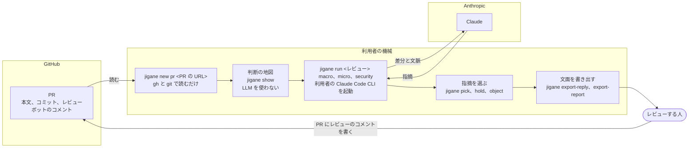
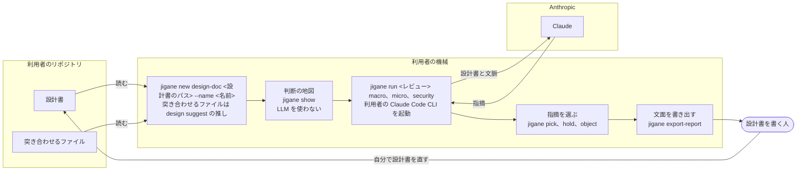

# jigane（地鉄）

[](https://github.com/kokiTakashiki/jigane/actions/workflows/ci.yml)

GitHub の Pull Request（以降、PR）のレビューのときに使う、Claude Code CLI を活用したレビュー補助の道具です。変更のどこに人の判断が要るかを LLM を使わずに示す判断の地図を主軸に、LLM による方針、実装、セキュリティの解析と、その指摘の敵対的検証を支えに持ちます。機能はすべて CLI として作っています。

名前の地鉄は、日本刀の刀身の鋼の肌を指します。鑑賞と鑑定では、作られた時代や流派を見極める見どころとされます。

## 想定する使い方

jigane は、レビューする人の手元の機械で動きます。想定する使い方は、GitHub の PR のレビューと、設計書のレビューの二つです。どちらも、変更のどこに人の判断が要るかを判断の地図にまとめ、利用者の Claude Code CLI で解析を走らせ、指摘を選んで文面を書き出します。PR へのコメントと設計書の直しは利用者が行い、jigane は GitHub へ書き込みません。

### GitHub の PR のレビュー

PR の情報とボットのコメントを gh で読み、リポジトリを複製して差分を git で取り出します。方針、実装、セキュリティの三つの群で解析します。



### 設計書のレビュー

実装の前に、設計書の綻びを問います。設計書と、突き合わせるリポジトリのファイルを読みます。突き合わせるファイルの既定は `jigane design suggest` の推しの候補すべてで、`--select` で選び直せます。検証メモなどの付属の文書は、`--with` で付けたときだけ読みます。PR のレビューと同じく、方針、実装、セキュリティの三つの群で解析します。



データがどこへ送られるかは「データの送り先と利用の条件」の節に、gh で呼ぶコマンドは「jigane が呼ぶ gh のコマンド」の節にまとめています。

## 対応する言語

判断の地図と flaky の検査は、tree-sitter で読む次の四言語に対応します。

| 言語 | 拡張子 |
|---|---|
| Python | `.py` |
| Java | `.java` |
| Swift | `.swift` |
| C# | `.cs`（`Foo.xaml.cs` は、対応する `Foo.xaml` のイベントの結線も読みます） |

ほかの言語のファイルも、レビューから外しません。判断の地図は、構文を読まずに変更の行をロジックの変更として扱い、確認が要る区間として示します。flaky の検査は、ほかの言語のファイルを調べません。方針、実装、セキュリティの解析は、言語でファイルを絞り込みません。ほかの言語は「外の言語を足す」の節の手順で足せます。

## 導入

次の二つの手順で使い始めます。

1. `uv tool install jigane` か `pipx install jigane` で入れます。

   ```bash
   uv tool install jigane
   ```

   ```bash
   pipx install jigane
   ```

2. `jigane languages fetch` で tree-sitter の文法を取得します。文法は、入れるだけでは揃わず、この手順のときだけ取得して記録した sha256 と照合し、レビューの実行のときには取得しません。

   ```bash
   jigane languages fetch
   ```

   取得の前に、利用規約とプライバシーポリシーの場所（`TERMS.ja.md`、`PRIVACY.ja.md` と英語版）を示して同意を求め（入れた版のリリースなら、その版のタグの文書を、それ以外は main の文書を示します）、y と答えたときだけ文法を取得します。標準入力が端末でないとき（CI や台本）は、`--accept-terms` を付けたときだけ取得します。

   ```bash
   jigane languages fetch --accept-terms
   ```

前提は次のとおりです。

- Claude Code CLI 2.1.257 以降にログイン済みであること。jigane は Claude Code を起動する前に `claude --version` で版を確かめ、2.1.257 より古いときと版を読み取れないときは起動せずに止まります
- Windows では、Claude Code の公式のインストーラで入れた claude.exe があること。npm で入れた claude.cmd は cmd.exe を通って起動され、JSON の引数を安全に渡せないため、jigane は起動しません。手順は <https://code.claude.com/docs/en/setup#install-on-native-windows> にあります
- git が使えること
- 差分レビュー式（PR の URL を取る）を使うなら、GitHub CLI（gh）にログイン済みであること。呼ぶコマンドは「jigane が呼ぶ gh のコマンド」の節に挙げます
- セキュリティのスキルで MCP サーバを使うなら（任意です）、データの置き場（既定は `~/.local/share/jigane`）の `mcp.json` に、使う MCP サーバの起動の設定を利用者が書くこと。MCP を使わない既定の実行には、`mcp.json` は要りません

## jigane が呼ぶ gh のコマンド

gh は利用者の認証で書き込みもできますが、jigane は読むだけで、書き込みません。呼ぶ形は次の三つに限り、コードの許可リストに合わない gh は起動する前に誤りにします。問い合わせ先は、環境変数 GH_HOST の値によらず github.com に固定し、GH_REPO は渡しません。

PR の情報を読みます。`jigane new pr` と、差分レビュー式の `jigane refresh` が呼びます。

```bash
gh pr view <番号> -R <owner>/<repo> --json number,url,title,body,baseRefOid,headRefOid,author
```

リポジトリを複製します。`jigane new pr` と、差分レビュー式の `jigane refresh` が、データの置き場にそのリポジトリのキャッシュが無いときに呼びます。

```bash
gh repo clone <owner>/<repo> <置き場> -- --bare --filter=blob:none
```

レビューボットのコメントを読みます。`jigane new pr` と、PR の先頭のコミットが進んだときの差分レビュー式の `jigane refresh` が呼びます。

```bash
gh api --method GET --paginate --slurp repos/<owner>/<repo>/pulls/<番号>/comments
```

このコマンドが読むのは、PR の行に付いたコメント（インラインコメント）だけです。このうち背景に入れるのは、レビューボットが書いた、行に付いたスレッドの先頭のコメントです。レビューボットとは、GitHub が Bot と示すアカウントと、`.jigane.toml` の `bots` に書いたアカウントです。本文は先頭の 2000 文字までを入れます。次のものは背景に入れません。

- スレッドへの返信。作者がボットの指摘に答えた返信（採否とその理由）も入りません。
- ファイル単位のコメントと、行を持たないコメント。
- 人が書いたインラインコメント。
- PR の会話のコメント（`gh pr comment` で書くもの）と、レビューの本文。このコマンドでは読みません。

## 配布物を検証する

PyPI の配布物が、公開リポジトリから Trusted Publishing で公開されたことを確かめられます。`pypi-attestations` は `pip install pypi-attestations` か `uv tool install pypi-attestations` で入れます。

```bash
pip download jigane==<version> --no-deps -d dist
pypi-attestations verify pypi --repository https://github.com/kokiTakashiki/jigane dist/<wheel のファイル名>
```

配布物が公開リポジトリの `release.yml` で作られたことは、GitHub の artifact attestation で確かめられます。GitHub CLI（`gh`）を使います。`--signer-workflow` で、署名したワークフローを `release.yml` に絞ります。

```bash
gh attestation verify dist/<wheel のファイル名> --repo kokiTakashiki/jigane \
  --signer-workflow kokiTakashiki/jigane/.github/workflows/release.yml
```

リリースには、利用規約（`TERMS.ja.md`、`TERMS.en.md`）、プライバシーポリシー（`PRIVACY.ja.md`、`PRIVACY.en.md`）、依存の一覧の SBOM（`sbom.cdx.json`）を添付します。規約とプライバシーポリシーは、`verify` が確かめたタグの木のものです。SBOM にも artifact attestation を付けるので、同じ `gh attestation verify` で検証できます。

## 実装済みの機能

次の機能がそろっています。

- 入力：PR の URL を取る差分レビュー式、git の範囲を取る範囲のレビュー、ファイル群を取る機能レビュー式、設計書を取る設計書のレビューです。差分レビュー式は、変更前と変更後のツリー、背景（本文が参照する文書、同じファイルに触れた過去の PR、CODEOWNERS）、レビューボットのコメントを集めます。
- 判断の地図：Python、Java、Swift、C# の四言語を tree-sitter で読み、変更を種類と判断の要否（重要、確認、機械）に分けます。どの段の変更も人が読むもので、段は読む順番を示すだけです。権限の差し替えや認証の除去のように振る舞いを変える本体の変更は、判断の地図が機械的に重い段へ上げられないことがあります。CodeQL や Semgrep のような静的検査を CI で併用してください。名前は例で、これらの道具が何を検出するかを jigane は保証しません。静的検査の結果（SARIF）を渡すと、指摘の付いた変更を「重要」に上げます（「静的検査の結果（SARIF）を取り込む」の節）。
- flaky の排除：四言語のテストの flaky の型を tree-sitter の query で検出し、直接の型をゲート違反、兆候の型を警告にします。
- スキル：方針（M0〜M6）、実装（D1〜D4、D6〜D11、T1〜T4）、セキュリティ（MASVS と ASVS。MCP は任意で、`--mcps` で選んだときだけ使います。例は mobile-sec と server-sec です）です。実装とセキュリティの指摘は敵対的に検証します。方針は、道具を渡さない一回の起動で、図と表だけから外形の綻びを指摘し、検証しません。指摘は選別して、実装はテーマに束ねます。
- 仕上げ：指摘の選別（pick、unpick、hold、unhold、object、unobject）、テンプレートによる返信とレポートの書き出しです。

## 使い方

副コマンドは、レビューを進める順に次の段階へ分かれます。トークンを使うのは `run` だけです。GitHub に繋ぐのは `new pr` と `refresh` で、`languages fetch` は tree-sitter の文法を取りに行きます。送り先の詳細は [docs/data-destinations.md](docs/data-destinations.md) を見てください。

<!-- BEGIN GENERATED: command-table (scripts/generate_command_table.py) -->

| 段階 | コマンド | claude を起動する | 役割 |
| --- | --- | --- | --- |
| レビューを作る | `new` | いいえ | レビューを作ります |
| レビューを作る | `refresh` | いいえ | 作者の修正を取り込みます |
| レビューを作る | `list` | いいえ | レビューを一覧します |
| レビューを作る | `archive` | いいえ | レビューを一覧から隠します。データは残ります |
| レビューを作る | `unarchive` | いいえ | アーカイブしたレビューを一覧へ戻します |
| レビューを作る | `delete` | いいえ | レビューを消します。戻せません |
| 見る | `show` | いいえ | レビューを表示します |
| 見る | `diagrams` | いいえ | ツリー図、シーケンス図、方針のレビューの図を出します |
| 見る | `sequence` | いいえ | 変更した入口ごとのシーケンス図を出します |
| 見る | `technology-list` | いいえ | 変更したファイルが使う技術の表を出します |
| 見る | `design` | いいえ | 設計書を読みます |
| 見る | `estimate` | いいえ | 入力の大きさを見積もります |
| 見る | `usage` | いいえ | スキルの使用量と成果を表で示します |
| 解析する | `run` | はい | スキルを実行します |
| 解析する | `flaky` | いいえ | テストの flaky の検査だけを走らせます（レビューは作りません） |
| 指摘を選ぶ | `pick` | いいえ | 指摘（F、B の番号）を最終的な指摘に加えます |
| 指摘を選ぶ | `unpick` | いいえ | 指摘（F、B の番号）を最終的な指摘から外します |
| 指摘を選ぶ | `hold` | いいえ | 指摘（F、B の番号）を保留にします |
| 指摘を選ぶ | `unhold` | いいえ | 指摘（F、B の番号）を保留から外します |
| 指摘を選ぶ | `object` | いいえ | 指摘への異議を記録します |
| 指摘を選ぶ | `unobject` | いいえ | 指摘への異議を取り下げます |
| 書き出す | `export-reply` | いいえ | 最終的な指摘から返信の文面を作ります（差分レビュー式） |
| 書き出す | `export-report` | いいえ | 最終的な指摘からレポートを書き出します |
| 書き出す | `templates` | いいえ | 返信とレポートのテンプレートを一覧します |
| 導入 | `languages` | いいえ | 言語を一覧し、外の言語を有効にし、外し、文法を取得します |

<!-- END GENERATED: command-table -->

`jigane` のコマンドで使います。レビューの識別子は、差分レビュー式が `<owner>/<repo>#<番号>`、範囲のレビューが `<owner>/<repo>@<名前>`、機能レビュー式が `<owner>/<repo>:<名前>`、設計書のレビューが `<owner>/<repo>+<名前>` で、`new` の出力に示します。コマンドの一覧は `jigane --help` で出ます。以下の例では、先頭の行が呼び方で、続く `#` の行が引数の意味です。`<レビュー>` はこの識別子です。識別子は、呼び出した場所のリポジトリのレビューの中で名前が一つに決まるときに限り、名前だけ（例 `payment`）でも指せます。0 件や 2 件以上（同じ名前の範囲と機能など）のときは拒み、候補を示します。

### レビューを作る

#### jigane new pr

```bash
jigane new pr <PR の URL> [--sarif <ファイル>]... [--sarif-root <ディレクトリ>]
# <PR の URL>: レビューする PR の URL
# --json: 結果を JSON で出す
# --sarif: 静的検査の SARIF。繰り返して渡せる。PR の先端のコミットで走らせたものを渡す
# --sarif-root: SARIF のパスの起点。省くと呼び出した場所を含む git のリポジトリの根
```

PR の差分、変更前と変更後のツリー、背景、レビューボットのコメントを集めて、差分レビュー式のレビューを作ります。

#### jigane new range

```bash
jigane new range <基点>..<先端> [--name <名前>] [--intent <文> | --intent-file <パス>] [--sarif <ファイル>]... [--sarif-root <ディレクトリ>]
# <基点>..<先端>: レビューする git の範囲
# --name: レビューの名前。省くと先端の名前から作る。同じ名前が既にあるときに別の名前を付ける
# --intent: 変更の意図の文。--intent-file と同時には渡せない
# --intent-file: 変更の意図を書いたファイル
# --sarif: 静的検査の SARIF。繰り返して渡せる。先端のコミットで走らせたものを渡す
# --sarif-root: SARIF のパスの起点。省くと呼び出した場所を含む git のリポジトリの根
```

git の範囲から、差分レビュー式のレビューを作ります。ほかのリポジトリをレビューするときは、そのリポジトリのディレクトリで `jigane` を呼びます。`jigane` は呼び出した場所で走るので、`new range` の範囲もそのリポジトリのものになります。

#### jigane new files

```bash
jigane new files <パス>... --name <名前> [--intent <文> | --intent-file <パス>] [--sarif <ファイル>]... [--sarif-root <ディレクトリ>]
# <パス>...: レビューするファイル。ディレクトリでもよい
# --name: レビューの名前（必須）
# --intent: 変更の意図の文。--intent-file と同時には渡せない
# --intent-file: 変更の意図を書いたファイル
# --sarif: 静的検査の SARIF。繰り返して渡せる。リポジトリの HEAD のコミットで走らせたものを渡す
# --sarif-root: SARIF のパスの起点。省くと呼び出した場所を含む git のリポジトリの根
```

ファイル群から、機能レビュー式のレビューを作ります。渡したパスが git のリポジトリの中にあれば、どこから呼んでも、そのリポジトリのレビューを作ります。パスが複数のリポジトリにまたがるとき、または git の中と外が混ざるときは失敗します。パスがすべて git の外にあるときは、これまでどおり作業ディレクトリを根にします。

#### jigane new design-doc

```bash
jigane new design-doc <設計書のパス> [--name <名前>] [--select <ファイル>...] [--with <ファイル>...]
# <設計書のパス>: レビューする設計書
# --name: レビューの名前。省くと設計書のファイル名から作る
# --select: 突き合わせるファイル。省くと design suggest の推しの候補すべて
# --with: 付属の文書（検証メモなど）。省くと付けない
```

設計書をレビューする（実装の前に方針の綻びを問う）レビューを作ります。突き合わせるファイルの既定は、`design suggest` の推しの候補すべてで、`--select <ファイル>...` で選び直せます。

#### jigane refresh

```bash
jigane refresh <レビュー> [--intent <文> | --intent-file <パス>] [--json] [--sarif <ファイル>]... [--sarif-root <ディレクトリ>]
# <レビュー>: 取り込み直すレビュー
# --intent: 変更の意図の文。--intent-file と同時には渡せない
# --intent-file: 変更の意図を書いたファイル
# --sarif: 静的検査の SARIF。繰り返して渡せる。保存した指摘をこの SARIF の指摘で置き換える
# --sarif-root: SARIF のパスの起点。省くと呼び出した場所を含む git のリポジトリの根
```

作者の修正を取り込みます。SARIF を渡したレビューの扱いは「静的検査の結果（SARIF）を取り込む」の節に書いています。

#### jigane list

```bash
jigane list [--archived] [--json]
# --archived: アーカイブしたものだけを出す
```

レビューを一覧します。

#### jigane archive と unarchive

```bash
jigane archive <レビュー> [--json]
jigane unarchive <レビュー> [--json]
# <レビュー>: 一覧から隠す、または一覧へ戻すレビュー
```

`archive` はレビューを一覧から隠します。データは残ります。`unarchive` は一覧へ戻します。

#### jigane delete

```bash
jigane delete <レビュー> [--yes] [--json]
# <レビュー>: 消すレビュー
# --yes: 確認を省く
```

レビューを消します。戻せません。

### 見る

#### jigane show

```bash
jigane show <レビュー> [overview|macro|micro|security] [--json]
# <レビュー>: 表示するレビュー
# overview|macro|micro|security: 表示する内容。省くと overview
```

レビューを表示します。SARIF を渡したレビューでは、概要に静的検査の指摘も出します（「静的検査の結果（SARIF）を取り込む」の節）。

#### jigane diagrams

```bash
jigane diagrams <レビュー> [--json]
# <レビュー>: 図を出すレビュー
```

ツリー図、シーケンス図、方針のレビューの図を出します。

#### jigane sequence

```bash
jigane sequence <レビュー> [--root <修飾名> | --region <判断の箇所>] [--side before|after|both] [--depth <数>] [--full] [--include-tests] [--format mermaid|json]
# --root: この修飾名の宣言を根とする図だけを出す
# --region: この判断の箇所が現れる図を引く
# --side: 変更前、変更後、両方のどれを出すか
# --depth: たどる深さ
# --full: 経路の切り詰めをしない
# --include-tests: テストも含める
# --format: 出力の形式
```

変更した入口ごとのシーケンス図を出します。

#### jigane technology-list

```bash
jigane technology-list <レビュー> [--json]
# --json: 技術選定のモデルを JSON で出す
```

変更したファイルが使う技術の表を出します。

#### jigane design suggest

```bash
jigane design suggest <設計書のパス> [--limit <数>] [--json]
# <設計書のパス>: 設計書（Markdown）のパス
# --limit: 推しの上限
```

設計書の名指しから、突き合わせるファイルを推します。`new design-doc` の `--select` の既定は、この推しです。

#### jigane estimate

```bash
jigane estimate <レビュー> macro|micro|security [--effort low|medium|high|xhigh|max] [--max-budget-usd-per-call <USD>] [--mcps <名前>...] [--mcp-guide <パス>] [--json]
# macro|micro|security: 見積もる群
# --effort: effort。省くと群の既定を使い、見積もりには解決した effort を出す
# --max-budget-usd-per-call: 1 回の起動あたりの上限の目安。この値で上限を決めた見積もりを出す
# --mcps: セキュリティの群だけが使う MCP の名前
# --mcp-guide: セキュリティの群だけが使う、MCP の使い分けの TOML
```

入力の大きさを見積もります。引数は `run` と同じ意味で、`--model` だけは受けません。

#### jigane usage

```bash
jigane usage <レビュー> [--json | --csv] [--wide] [--no-header]
# --json、--csv: 表の代わりに出す形式。常に全列
# --wide: 表に全ての列を出す
# --no-header: --csv で見出しの行を出さない
```

スキルの使用量と成果を表で示します。

### 解析する

#### jigane run

```bash
jigane run <レビュー> macro|micro|security [--model <モデル>] [--effort low|medium|high|xhigh|max] [--max-budget-usd-per-call <USD>] [--mcps <名前>...] [--mcp-guide <パス>] [--json]
# macro|micro|security: 走らせる群
# --model: その回の全ての役のモデル。省くと群の既定
# --effort: Claude Code CLI の effort。省くと群の既定
# --max-budget-usd-per-call: 1 回の起動あたりの上限の目安（USD）
# --mcps: セキュリティの群だけが使う MCP の名前
# --mcp-guide: セキュリティの群だけが使う、MCP の使い分けの TOML
```

スキルを実行します。群は `macro`、`micro`、`security` の三つです。`--max-budget-usd-per-call` は Claude Code CLI の 1 回の起動あたりの上限の目安であり、超えることがあります（上限は API の呼び出しごとに確かめるため、最後の一回の分だけ超えうる）。実行全体の上限でもありません。方針は起動が 1 回なので、この目安が実行全体の目安になります。見込みが目安以上のときは、警告して続けます。

既定は群ごとに持ち、どの群も 0.5 USD です。上限と effort の既定は設定ファイルから読まず、変えるときは引数で渡します。

モデルも群ごとの既定（全群 claude-sonnet-5-5。effort は方針が high、他は渡さない）で、`--model` と `--effort`（low、medium、high、xhigh、max）で上書きできます。`jigane estimate` も `--effort` を受け、見積もりに解決した effort を出します。実行全体の金額と起動の回数は `run` の出力に示します。

セキュリティの群だけが、`--mcps <名前>...` で MCP を選べます。MCP は任意で、`--mcps` を渡さなければ使いません。使う MCP は利用者がデータの置き場の `mcp.json` に書き、名前はその `mcpServers` のキーです。MCP の使い分けを書いたファイルは、「セキュリティの群の MCP の使い分け」の節で渡し方を述べます。

終了コード 3 は、シャードか検証の分割が失敗し、結果に未検証の候補を含むことを表します。未検証の候補は、実装とセキュリティの群で「未検証」の区分の指摘として残り、必読に数えず、`show` で必読の直後の節に出ます。

#### jigane flaky

```bash
jigane flaky [<パス>...] [--strict] [--json]
# <パス>...: 検査するファイルかディレクトリ。省くと作業ディレクトリの作業ファイル全体
# --strict: 警告でも終了コード 1 にする
```

テストの flaky の検査だけを走らせます。レビューは作りません。詳しくは、別の節（「flaky の単独検査」）にまとめています。

### 指摘を選ぶ

#### jigane pick と unpick

```bash
jigane pick <レビュー> <指摘>... [--json]
jigane unpick <レビュー> <指摘>... [--json]
# <指摘>...: 指摘の番号（F1、B2 など）
```

`pick` は指摘を最終的な指摘に加えます。`unpick` は外します。

#### jigane hold と unhold

```bash
jigane hold <レビュー> <指摘>... [--json]
jigane unhold <レビュー> <指摘>... [--json]
# <指摘>...: 指摘の番号（F1、B2 など）
```

`hold` は指摘を保留にします。`unhold` は保留から外します。

#### jigane object と unobject

```bash
jigane object <レビュー> <指摘> --reason <理由> [--json]
jigane unobject <レビュー> <指摘> [--json]
# <指摘>: 指摘の番号（F1、B2 など）。一件ずつ渡す
# --reason: 異議の理由（object の必須）
```

`object` は指摘への異議を記録します。`unobject` は取り下げます。

### 書き出す

#### jigane export-reply と export-report

```bash
jigane export-reply <レビュー> --template <テンプレート> [--out <パス>] [--json]
jigane export-report <レビュー> --template <テンプレート> [--out <パス>] [--json]
# --template: テンプレートの名前（必須）。名前は templates で一覧する
# --out: 書き出すファイル。省くと標準出力へ書く
# --json: 文面を {"body": "..."} の JSON で包んで出す
```

`export-reply` は最終的な指摘から返信の文面を作ります（差分レビュー式）。`export-report` はレポートを書き出します。`--out` を省くと標準出力へ書きます。`--json` を付けると、文面を `{"body": "..."}` の JSON で包んで出します（`--out` と組み合わせると、ファイルにその JSON を書きます）。失敗は `{"error": {...}}` を標準出力へ出します。

#### jigane templates

```bash
jigane templates [--json]
```

返信とレポートのテンプレートを一覧します。

### 導入

#### jigane languages

```bash
jigane languages list [--json]
jigane languages enable <名前> [--distribution <配布>] [--json]
jigane languages disable <名前> [--distribution <配布>] [--json]
jigane languages fetch [--accept-terms]
# <名前>: 外の言語の名前
# --distribution: 同じ名前が複数の配布にあるときに、使う配布を選ぶ
# --accept-terms: 利用規約とプライバシーポリシーに同意したものとして、尋ねずに取得する
```

`list` は組み込みと外の言語を一覧します。`enable` は外の言語を有効にし、`disable` は外します。`fetch` は組み込みと有効な外の言語の文法を取得して照合します。導入の手順は「導入」の節に、外の言語の足し方は「外の言語を足す」の節にあります。

## 静的検査の結果（SARIF）を取り込む

静的検査の道具が書き出した結果を渡すと、指摘の付いた変更を判断の地図の「重要」に上げ、指摘を `show` で示します。jigane は道具を起動せず、道具も規則も配りません。道具は利用者が選び、CI か手元で走らせて SARIF を書き出します。Ruff、detekt、Android Lint、SwiftLint、CodeQL、Semgrep が例です。これらは例で、道具のライセンスと契約は利用者の側に残ります。jigane が読むのは SARIF 2.1.0 だけで、それより前の版は読みません。

### 使い方

SARIF は、`new pr`、`new range`、`new files`、`refresh` の `--sarif` で渡します。道具ごとに別のファイルを出す使い方が多いため、繰り返して渡せます。SARIF のパスをリポジトリの相対パスに直す起点は `--sarif-root` で決めます。省くと、jigane を呼び出した場所を含む git のリポジトリの根になります。CI で別の場所に checkout して走らせた SARIF や、モノレポの下位のディレクトリで走らせた SARIF を渡すときに、`--sarif-root` でその場所を指します。`--sarif-root` は `--sarif` と一緒にしか渡せません。場所は設定ファイルでなく引数で渡すので、CI から呼ぶときはスクリプトに書いてください。

```bash
ruff check --output-format sarif > ruff.sarif
jigane new range main..feature --sarif ruff.sarif
```

SARIF は、レビューの変更後のコミット（PR では先端、範囲では `<先端>`、`new files` ではリポジトリの HEAD）で走らせたものを渡します。指摘の行番号は、そのコミットの行を指すものとして重ねるためです。

### 上げる条件

`error` と `warning` の指摘は、行が重なった区間を、種類 `static_finding` の「重要」に上げます。すでに「重要」の区間は種類を変えず、指摘だけを添えます。`level` が無い指摘は `warning` とみなします。`note` と `none` は区間を上げず、重なった区間に添えて示すだけです。書き方の指摘で「重要」が埋まるのを避けるためです。上げる区間の数に上限は置きません。数が膨らんだことには、概要に出る上げた判断の箇所の数で気づけます。

SARIF は区間を上げる方向にしか効きません。区間を「確認」や「機械」に下げて隠すことはできません。

### 解析したコミットの確かめ

SARIF の `versionControlProvenance` に `revisionId` があり、レビューの変更後のコミット（完全な SHA）と違えば、読み込まずに止めます。`revisionId` が無い SARIF は、警告を出して読み込み、そのときの変更後のコミットを、解析したコミットとして保存します。Ruff のように、この欄を書かない道具があるためです。この場合は、別のコミットで走らせた SARIF を渡しても jigane は気づけず、ずれた行に指摘が重なりえます。変更後のコミットで走らせた SARIF を渡してください。

### 作り直し

`refresh` で変更後のコミットが解析したコミットと同じなら、保存した指摘を作り直した区間に重ね直します。変更後のコミットが進んでいれば、保存した指摘の行番号は前のコミットの行を指すので、重ね直さずに警告します。新しいコミットで走らせた SARIF を `--sarif` で渡し直してください。`refresh` に `--sarif` を渡すと、保存した指摘を新しい SARIF の指摘で丸ごと置き換え、解析したコミットを新しい変更後のコミットにします。

### 取り込みの形

指摘は、渡したファイル、その中の run、その中の結果の順に `S1`、`S2` と番号を振ります。位置は、各指摘の最初の位置だけを使います。レビューの置き場には、正規化した指摘（道具の名前と版、規則、重さ、文、リポジトリの根からの相対パス、行の範囲）を保存し、元の SARIF は保存しません。差分の外の行や、変更していないファイルに付いた指摘は、区間を持たないので上げません。件数だけを「差分の外」として示します。

### 捨てる条件

次の指摘は取り込まずに捨て、理由ごとの件数を `show` に出します。

| 理由 | 捨てる指摘 |
| --- | --- |
| `no_location` | 位置、URI、開始行のどれかが無い |
| `unsupported_scheme` | URI のスキームが `file:` でも相対でもない（`http:` など） |
| `malformed_uri` | `file:` の URI で、スキームの後がパスの形（`/` で始まる）でない |
| `nul_character` | URI かパスに NUL 文字がある |
| `control_character` | パスに制御文字がある |
| `file_uri_with_host` | `file://server/...` のようにホストを持つ `file:` の URI |
| `outside_analysis_root` | `file:` の絶対パスが、解析の根の下にない |
| `drive_letter` | `C:/x` のようにドライブ文字で始まる |
| `unc_path` | `//` で始まる（UNC） |
| `absolute_path` | 正規化した後も絶対パスである |
| `parent_reference` | `..` で始まる |
| `not_a_file` | 正規化すると `.` になり、ファイルを指さない |
| `outside_repository` | リポジトリの根の外を指す |

相対の URI は、`uriBaseId` を見ずに、解析の根からの相対パスとして読みます。

### 上限

SARIF は信頼できない入力として読みます。次を超えると、読み込まずに止めます。

- 1 回の呼び出しで渡す SARIF は 20 ファイルまでです
- 1 ファイルは 20 MB まで、合計は 50 MB までです
- 指摘は、1 回の呼び出しの合計で 10,000 件までです
- JSON として読めないファイルと、入れ子が深すぎるファイルは拒みます
- 通常のファイルだけを読みます。FIFO、デバイス、ディレクトリは拒みます。シンボリックリンクは、先が通常のファイルなら読みます

文字列は、制御文字と端末のエスケープ列を除いたうえで、道具の名前と版を 100 文字、規則を 200 文字、文を 2,000 文字で切ります。使う欄の型が違えばファイル全体を拒み、知らない欄は読み捨てます。

### show での見え方

`jigane show` の概要に、取り込んだ指摘の件数、上げた判断の箇所の数、差分の外の件数、捨てた件数と理由ごとの内訳を出し、指摘の付いた区間ごとに道具、規則、重さ、文を添えます。`--json` では `static_findings` の欄に同じ内容を入れます。指摘の文は Claude には渡しません。方針の群が受け取るのは、区間が上がったことと種類、指摘の件数だけです。

## セキュリティの群の MCP の使い分け

セキュリティの群には、`--mcp-guide <パス>` で、MCP の使い分けを書いた TOML を渡せます。`run` と `estimate` が同じ引数を受け、ほかの群に渡すと起動の前に誤りになります。ファイルは MCP の名前ごとの表に、使う変更を書く `use_for` の一文だけを持ちます。

```toml
[mcps.mobile-sec]
use_for = "iOS と Android のアプリのコード"

[mcps.server-sec]
use_for = "サーバ、API、サーバ上で動くプラグインのコード"
```

jigane は読む前に三つを確かめ、外れたら起動の前に止めます。

- 形：最上位は `mcps` の表だけで、各表は `use_for`（空でない文字列）だけを持つこと。知らない鍵は誤りです
- 名前：`mcp.json` の `mcpServers` にあること
- 集合：名前の集合が `--mcps` と同じであること。`--mcps` を渡さずに `--mcp-guide` だけ渡すと、集合が違うので誤りです

確かめた中身は、セキュリティのプロンプトに「- <名前>: <use_for>」の箇条書きで入り、見積もりの入力にも数えます。`--mcp-guide` を省くと使い分けの文は渡しません。

## 外の言語を足す

外のパッケージから言語を足せます。パッケージを jigane と同じ環境に入れ（`uv tool install` で入れた jigane には `uv tool install jigane --with <パッケージ>`、`pipx` で入れた jigane には `pipx inject jigane <パッケージ>`、それ以外は `pip install` か `uv pip install`）、`jigane languages enable <名前>` で有効にします。

配布が複数あって言語名が重なるときは `--distribution <配布名>` で選びます。

enable は外のコードを読み込む前に、信頼の注意と配布の名前と版を示し、端末で y と答えたときだけ読み込んで検証し、データの置き場の `languages.json` に、言語と配布の名前と版、承認した時点の配布の中身（RECORD に載る各ファイルの sha256）を記録します。起動のたびに、読み込む前に配布の中身を記録と照らし、版が違うときも、同じ版のままファイルが変わったり欠けたりしたときも読み込みません。配布を更新したら、もう一度 `jigane languages enable <名前>` で確認を取ります。RECORD の無い配布は有効にできません。中身を記録する前の形の記録は読めますが、承認としては使わないので、もう一度 enable を求めます。中身が変わったときは、変わった、欠けた、増えたファイルの相対パスを種類つきで合わせて最大 5 件まで理由に示し（ハッシュの値は示しません）、enable の確認でも同じ理由を示します。`jigane languages disable <名前>` で外します。

文法は、導入の後に `jigane languages fetch` で取得します。プラグインが宣言したパックの版と sha256 に合わない文法は読み込みません。

`jigane languages list [--json]` は、言語ごとの出どころ、状態、拡張子、使える図と対応外の図を示します。有効にした言語が使えないと、`languages` の副コマンド以外は止まります。

作り方の例は `examples/jigane-language-kotlin/README.md` にあります。

外の言語のコードと文法の共有ライブラリは、jigane と同じ権限で動きます。jigane は審査しません。出どころを確かめてから有効にします。詳しくは SECURITY.md の「外の言語」を読んでください。

## 既知の限界

指摘が 0 件でも、問題が無いことを意味しません。

実装の群（micro）は、小さな範囲で短い時間のまま 0 件を返す回があります。同じ範囲をもう一度走らせると、指摘が出ることがあります。

モデルが、レビューの対象のコードや PR の文に書かれた命令に従わないことは保証できません。詳しくは SECURITY.md の「レビューの入力と Claude Code」を読んでください。

方針の群は、自作の仕組みを既製の道具に置き換える提案を挙げ漏らすことがあります。

## データの送り先と利用の条件

### 非公式の位置づけ

jigane は Anthropic の提携も承認も受けていない、個人が作る非公式の道具です。

利用規約は `TERMS.ja.md`（英語版は `TERMS.en.md`）、プライバシーポリシーは `PRIVACY.ja.md`（英語版は `PRIVACY.en.md`）に置いています。いずれもリポジトリの根にあります。

### データの送り先

jigane が外へ送る相手、送るもの、時機、口は `docs/data-destinations.md` にまとめています。レビューの対象の差分、PR の本文とコメント、周辺のファイルは、利用者が導入した Claude Code を通じて Anthropic に送られます。学習への利用と保持の期間は、利用者自身の Anthropic のアカウントの設定と契約に従います。詳しくは <https://code.claude.com/docs/en/data-usage> を読んでください。機密のリポジトリでは、契約と設定を確かめてから使ってください。

### 利用の条件

jigane の利用は、利用者自身の Claude Code の契約と規約（<https://code.claude.com/docs/en/legal-and-compliance>）に従います。jigane は資格情報を読まず、保存しません。ログインは利用者の Claude Code に任せます。

### 起動の回数と費用

`jigane run` は、起動の前に `claude -p` の起動の回数と見積もりの額を示し、同意を求めます。標準入力が端末でないときは起動しません。方針の群は 1 回起動します。実装とセキュリティの群は、シャードの数（最大 4）と検証役の分を起動します。検証役の回数は見つかった指摘の数で決まり、上限を持ちません。1 回の起動の上限は既定で 0.5 USD です。判断の地図の区間に、アダプタの無い言語のソースのファイル（Markdown、JSON、YAML、TOML のような文書とデータの形式と、拡張子の無いファイルは除きます）があるときは、費用の同意の y に続けて、言語ごとのファイルを示し、それらの区間は宣言を読まずに「確認」になること、アダプタは `jigane languages` で足せることを伝えたうえで、「それでもレビューを実施しますか（y/N）」と問い、y か yes のときだけ起動します。設計書のレビューでは問いません。

### 文法の取得

言語の文法は `jigane languages fetch` のときに GitHub のリリースから取得し、記録した sha256 と照合します。レビューの実行のときには取得しません。

文法の sha256 の記録がある platform は次のとおりです。

- `linux-aarch64`
- `linux-x86_64`
- `macos-arm64`
- `macos-x86_64`
- `windows-aarch64`
- `windows-x86_64`

記録の無い platform では照合できないため、組み込みの文法を読み込まずに止めます。その platform への対応は Issue で知らせてください。

## flaky の単独検査

レビューを作らずにテストの flaky の検査だけを走らせるには `flaky` を使います。レビューのゲートが使う検出器と同じもので、LLM を呼ばず、`JIGANE_HOME` にも何も書きません。ファイル全体を検査し、違反（G）と警告（W）を、ファイルと行、懸念、理由、直す向きの順に出します。パスを省くと作業ディレクトリの作業ファイル全体（git の作業木なら、追跡しているファイルに加えて、追跡外で ignore されていないファイル。手元で書いたばかりのテストも見る）、ディレクトリを渡すとその下に絞ります。テストと判定されないファイルは見ません。

```bash
jigane flaky [<パス>...] [--strict] [--json]
```

違反があれば終了コード 1、警告だけなら 0 で、`--strict` なら警告でも 1 になります。

`--json` は `violations`、`warnings`（各要素は `id`、`kind`、`path`、`line`、`concern`、`violation`、`direction`）と、`counts` を出します。

ほかのリポジトリの CI には、次のように一つのステップとして置けます。

```yaml
- name: flaky 検査
  run: jigane flaky --strict
```
