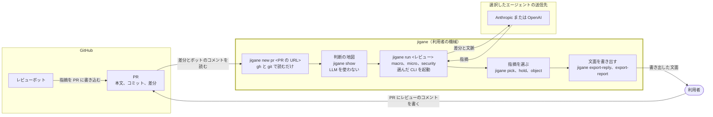

# jigane（地鉄）

[](https://github.com/kokiTakashiki/jigane/actions/workflows/ci.yml)

jigane は、コードの変更や設計書をレビューする CLI です。まず、どこに人の判断が要るかを示す「判断の地図」を、手元で LLM を使わずに作ります。次に Claude Code または Codex がレビューし、利用者が採用する指摘を選びます。

## GitHub の PR をレビューする流れ



## 導入

Python 3.12〜3.14 と Git を用意し、jigane と言語解析用の文法をインストールします。

```bash
uv tool install jigane
jigane languages fetch
```

pipx を使う場合は、1行目を `pipx install jigane` に替えます。文法の取得時には、表示された利用規約とプライバシーポリシーを確認して同意します。

### Claude Code を使う場合

Claude Code CLI 2.1.308 以降にログインし、`jigane select-agent claude` を実行します。Windows では公式インストーラで `claude.exe` を導入してください。[Windows の導入手順](https://code.claude.com/docs/en/setup#install-on-native-windows)

### Codex を使う場合

Codex CLI にログインし、`jigane select-agent codex` を実行します。端末でもデスクトップ版でも、Codex CLI に保存した ChatGPT ログインを使います。対応 OS は macOS と Linux です。jigane には Codex CLI のバージョン番号による起動制限はありません。

## レビューする

どちらのエージェントでも手順は共通です。たとえば、対象の Git リポジトリで直近のコミットを `payment` という名前でレビューするには、次のコマンドを使います。

```bash
jigane new range HEAD~1..HEAD --name payment
jigane estimate payment macro
jigane run payment macro
jigane show payment macro
```

`estimate` で見積もりを確認し、`run` で送信に同意するとモデルがレビューを始めます。`show` で保存済みの指摘を読みます。方針は `macro`、実装は `micro`、セキュリティは `security` を指定して、1群ずつ実行します。

GitHub の PR を調べる場合は GitHub CLI（`gh`）にログインし、最初の行を `jigane new pr <PR の URL>` に替えます。設計書なら `jigane new design-doc <設計書のパス>` です。以降のコマンドでは `payment` の代わりに `new` が表示したレビューの識別子を使います。

採用する指摘を番号で選び、レポートに書き出せます。たとえば `F1` を採用する場合は、次のようにします。

```bash
jigane pick payment F1
jigane export-report payment --template report --out review.md
```

## 文書の一覧

| 知りたいこと | 文書 |
| --- | --- |
| PR・設計書のレビュー手順、更新方法 | [使い方](docs/usage.md) |
| Claude Code と Codex の設定・予算・MCP の違い | [レビュー設定の比較表](docs/usage.md#レビュー設定の違い) |
| コマンドと引数、レビューに渡す文書の設定 | [コマンド一覧](docs/commands.md#コマンド一覧)・[リポジトリの文書を渡す](docs/commands.md#リポジトリの文書を渡す) |
| 方針・実装・セキュリティで調べる内容、指摘の読み方 | [レビューの内容](docs/reviews.md) |
| 見積もりと実行後の費用 | [起動の回数と費用](docs/cost.md) |
| セキュリティレビューの MCP 資料とエージェント別の登録方法、静的検査の取り込み | [MCP の設定](docs/security-mcp.md)・[SARIF の取り込み](docs/sarif.md) |
| 対応する言語と追加方法 | [言語の対応範囲](docs/adding-languages.md#組み込みの対応言語)・[言語の追加](docs/adding-languages.md) |
| インストール環境と配布物の確認 | [Python の対応バージョン](docs/python-versions.md)・[配布物の検証](docs/verify-distribution.md) |

## データの送り先と利用の条件

レビュー資料は選んだエージェントに応じて Anthropic または OpenAI に送られます。モデルの利用には各サービスの契約と規約が適用されます。jigane は個人開発の非公式ツールです。Anthropic とも OpenAI とも提携しておらず、どちらの承認も受けていません。[データの送り先](docs/data-destinations.md)・[利用規約](TERMS.ja.md)・[プライバシーポリシー](PRIVACY.ja.md)・[Claude Code の契約と利用条件](https://code.claude.com/docs/en/legal-and-compliance)
