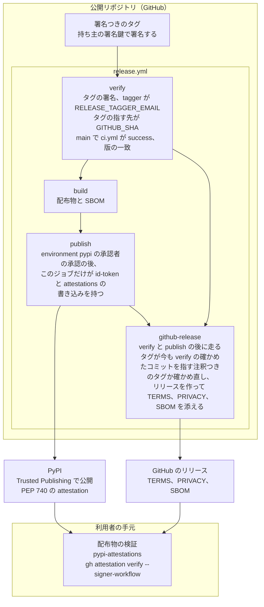

# セキュリティの方針

## 脆弱性の報告

脆弱性は公開の Issue に書かず、GitHub の Private vulnerability reporting（リポジトリの Security タブの「Report a vulnerability」）で報告してください。報告には、影響を受ける版かコミット、再現の手順、想定する影響を含めてください。

受け取った報告には 7 日以内に返事をし、修正の見込みを伝えます。修正を出すまで、報告の内容を公開しないでください。

## 対象

対象は、このリポジトリの `jigane` のパッケージ（CLI、プロンプト、言語アダプタ）と、その配布物です。jigane が起動する外部の道具（Claude Code CLI、gh、git、MCP サーバ）の脆弱性は、それぞれの提供元へ報告してください。

配布物の検証の手順は、README の「配布物を検証する」に書いています。

## 配布物の流れ

配布物は、公開リポジトリのタグから `release.yml` を通って PyPI に届きます。利用者が確かめられる範囲を次の図に示します。公開リポジトリは Pull Request を受け付けず、Issue だけを受けます。

## 守っている前提

### データと外部コマンド

- jigane はレビューの記録をデータの置き場（既定は `~/.local/share/jigane`、`JIGANE_HOME` で変えられる）にだけ書きます。
- 外部コマンドは引数の配列で起動し、シェルを経由しません。
- tree-sitter の文法は `jigane languages fetch`（開発の木では `make setup`）で仮想環境の中（`<sys.prefix>/share/jigane/grammars/`）へ取得し、読み込みの前に共有ライブラリの sha256 をリポジトリの記録（`jigane/languages/grammar-hashes.json`）と照合します。合わなければ読み込まず、実行時には取得しません。記録の無い platform では照合できないため、組み込みの文法を読み込まずに止めます。

### レビューの入力と Claude Code

- PR の本文、コメント、レビュー対象のコードは、信頼しない入力として Claude Code に渡ります。PR の本文、コメント、コードの中の文が命令のように書かれていても、Claude Code がそれに従ってしまうことはありえます（プロンプトインジェクション）。jigane はこれを防ぎきれません。
- そこで Claude Code の権限を絞ります。jigane は `--restricted` を付け、`--tools` で渡す道具を `Read`、`Grep`、`Glob` などの読み取りだけにします（群によっては `Read` だけ、または道具なし）。コマンドの実行、書き込み、ネットワークの道具は渡しません。道具は作業ディレクトリの中に閉じます。その根拠は、`--restricted` と、`--settings` で渡す `permissions.blockReadsOutsideWorkingDirectories`（作業ディレクトリの外の読み取りを拒む設定）です。
- `blockReadsOutsideWorkingDirectories` は Claude Code 2.1.257 以降で効き、それより古い版では無視されうるため、2.1.257 以降を使ってください。`--tools` に Bash などシェルの道具を渡すと、この設定とは別の経路で作業ディレクトリの外を読めます。jigane は既定でシェルの道具を渡しません。
- 読み取りの道具は、作業ディレクトリの中の秘密（`.env` など）も読めます。秘密を含む作業ディレクトリをレビューの対象にしないでください。読んだ内容はレビューの結果に載り、返信やレポートの文面に入ることがあります。jigane は既知の秘密のファイル名（`.env`、`*.pem`、`id_rsa`、`*.tfvars` など）の読み取りを拒む設定を渡します。反証役が示した位置の抜粋にも、プロンプトに本文を載せるシャードの単位にも、同じ一覧に当たるファイルは入れません。差分では、改名や複写の前後どちらかの名前が当たれば、その変更を丸ごと除きます。単位から除いたファイルは、実行の注意に名前を出し、レビューしません。一覧に無い名前の秘密は読めます。
- MCP サーバは、データの置き場の `mcp.json` に書き、`--mcps` で選んだものだけが起動します（セキュリティの群が使います）。利用者の Claude Code の設定や claude.ai のコネクタの MCP サーバは読ませません。渡し方は、下の表の「--strict-mcp-config」と「--mcp-config」の行のとおりです。どのサーバを使うかは、実行の前に表示される確認で、利用者が y と答えて承認します。サーバは出所を確かめたものだけを `mcp.json` に書いてください。`--mcps` で渡したサーバの道具は、道具ごとには承認を求めず、全てを使える状態で渡します。確認で y と答えることが、その全てへの承認です。PR の本文やコードの命令で書き込みやネットワークの道具を呼ばれないよう、読み取りだけの道具を持つサーバだけを渡してください。
- 選んだサーバの設定（認証情報が入りうる）は、一時ファイルに書いて使い終われば消します。権限は POSIX では `0600` に絞ります。Windows では一時ファイルの権限を絞らず、利用者ごとの一時のディレクトリの既定の ACL に頼ります。
- 子のプロセスの環境から GitHub のトークンの変数を除きます。変数の名前は、下の表の「渡さないもの」のとおりです。
- 環境変数 `JIGANE_CLAUDE_BINARY` は、起動する `claude` の実行ファイルを差し替えます。他人が環境変数を設定できる場所で jigane を動かさないでください。
- レビュー対象のコードと PR の文は、利用者の Claude Code を通じて Anthropic に送られます。送ってよい内容かは、利用者が判断してください。

<!-- BEGIN GENERATED: claude-inputs-table (scripts/generate_claude_inputs_table.py) -->

Claude Code が自分で足してモデルへ送る情報（Claude Code の版や設定による）は、この表の外です。

「渡る群」の macro は方針、micro は実装、security はセキュリティの群です。

#### 渡すもの

| 経路 | 中身 | 渡る群 | 利用者も手で渡せるか |
| --- | --- | --- | --- |
| 標準入力 | 変更の差分（変更前と変更後の行）。機能レビューでは変更前は空の旨の固定文。差分に添える設定ファイルの冒頭（Makefile、justfile、pyproject の最大 40 行）を含む | micro、security | はい（git diff と同じ内容） |
| 標準入力 | レビューの対象のファイルの一覧と本文。群によって中身が違う。micro と security は担当のファイルの本文（差分に添える設定ファイルの冒頭を含む）、macro はレビューの範囲とファイルの一覧と、そこから描いた図だけで本文は渡らない | macro、micro、security | はい（作業ディレクトリのファイル） |
| 標準入力 | 変更前の木の中身。図、判断の地図、同じ形の箇所、技術選定を通して入る | macro | はい（変更前のコミットの中身で git show で取れる。置き場は作業ディレクトリの外） |
| 標準入力 | 変更の意図（PR の題と本文、--intent、コミットのメッセージ、設計書の宣言）と、PR の本文が参照する文書のパス（パスだけで、文書の本文は載せない） | macro | はい（gh と git log で利用者も渡せる） |
| 標準入力 | 同じファイルに触れた過去のコミットの短縮 SHA と題 | macro | はい（git log で取れるが、どれを足すかは jigane が選ぶ） |
| 標準入力 | 同じファイルに触れた過去の PR の番号と題 | macro | はい（gh で取れるが、どれを足すかは jigane が選ぶ） |
| 標準入力 | 変更したパスの持ち主 | macro | はい（リポジトリの CODEOWNERS ファイル） |
| 標準入力 | レビューボットのコメント（ログイン名、位置、本文） | macro | はい（gh で取れるが、整形は jigane） |
| 標準入力 | 判断の地図（変更の種類、判断の要否、箇所） | macro | はい（利用者自身のコードと変更から jigane が整形したもの） |
| 標準入力 | 技術の追加と削除、依存の宣言の変化 | macro | はい（利用者自身の依存の宣言から jigane が整形したもの） |
| 標準入力 | 同じ形の箇所（消した行と同じ行が残る箇所、重なる塊）の宣言の抜粋 | macro | はい（利用者自身のコードから jigane が整形したもの） |
| 標準入力 | 設計書の本文、節の構造、名指しの照合、選んだファイルの対応と、そのファイルから描いたいまの形の図 | macro、micro、security | はい（作業ディレクトリのファイル。構造と照合は jigane が付ける） |
| 標準入力 | 前の回の指摘と利用者の異議、他のレビューの指摘 | macro、micro | はい（利用者自身の前のレビューと異議から jigane が整形したもの） |
| 標準入力 | 方針の群の指摘を実装の群へ渡した懸念 | micro | はい（利用者自身のレビューの指摘から jigane が整形したもの） |
| 標準入力 | 同じレビューの前の段の出力（指摘の候補と、その検証） | micro、security | はい（利用者自身のレビューの前の段の出力から jigane が整形したもの） |
| 標準入力 | 検証の段で確かめた位置の抜粋。jigane が作業ディレクトリから読み直して渡す | micro、security | はい（作業ディレクトリのファイル。秘密のファイル名は除く） |
| 標準入力 | 利用者の MCP の使い分けの TOML と、使える MCP の名前の注記 | security | はい（利用者自身が jigane に渡した設定を jigane が整形したもの） |
| 標準入力 | jigane の雛形の固定の文で、利用者のデータではない（観点、基準、範囲の規則、捨てる理由の表、担当のファイルの番号など） | macro、micro、security | はい（公開の雛形の文。利用者のデータを含まない） |
| コマンドの引数 | --restricted、--tools、--settings の秘密のファイル名の deny と作業ディレクトリの外の読み取りの拒否、--strict-mcp-config | macro、micro、security | はい（利用者も渡せる。値の組は jigane のもの） |
| コマンドの引数 | --output-format json と --json-schema（段ごとの出力の形） | macro、micro、security | はい（jigane の固定の出力モデルから作る文） |
| コマンドの引数 | --model、--effort、--max-turns、--max-budget-usd | macro、micro、security | はい（利用者も渡せる） |
| コマンドの引数 | --mcp-config の一時ファイル（利用者の mcp.json から選んだサーバの定義）と --allowedTools | security | はい（利用者の MCP の設定。認証情報を含みうる） |
| 環境変数 | ENABLE_CLAUDEAI_MCP_SERVERS=false と CLAUDE_CODE_DISABLE_NONESSENTIAL_TRAFFIC=1。jigane が自分のプロセスに設定し、子が受け継ぐ文法の置き場のパス（TREE_SITTER_LANGUAGE_PACK_CACHE_DIR）。このパスの値は利用者名を含む絶対パスで、jigane の仮想環境の中の文法の置き場を指す | macro、micro、security | いいえ（jigane が足す） |
| 環境変数 | 除いたものと足したものを除く、親の環境のそのまま（文法の置き場のパスは含まない）。利用者の環境に置いた API キーやトークン（CLAUDE_CODE_OAUTH_TOKEN を含む）もそのまま受け継ぐ | macro、micro、security | はい（普通の利用でも受け継ぐ） |
| 作業ディレクトリ | cwd。機能と設計書は利用者のリポジトリの根、範囲と PR はデータの置き場の中の変更後の木。Claude Code は cwd のパスを自分の環境の情報としてモデルへ送る（Claude Code 2.1.292 で、道具を使わずにパスを答えることを確かめた）。範囲と PR ではそのパスに利用者名、JIGANE_HOME、owner/repo、レビューの識別子（@ の後に 40 桁の SHA を含む）が入る | macro、micro、security | いいえ（範囲と PR では cwd が jigane のデータの置き場の中になり、利用者が手で claude を起動するときの cwd と違う。機能と設計書では利用者のリポジトリの根で、手でも同じ） |

環境変数は Claude Code のプロセスに置かれるだけです。jigane が渡す道具は Read、Grep、Glob と、MCP の資源を読む ReadMcpResourceTool、ListMcpResourcesTool だけで、--restricted と blockReadsOutsideWorkingDirectories で作業ディレクトリの中に閉じるので、モデルが環境変数を読んで送る道具は jigane からは渡りません。ただし --mcps で渡した MCP サーバは、Claude Code が起動するプロセスで、環境変数を受け継ぐことがあります。その道具が何を読んでモデルへ返すかは、サーバによります。

#### 渡さないもの

| 経路 | 中身 | 理由 |
| --- | --- | --- |
| 環境変数 | GitHub のトークンの変数 GH_ENTERPRISE_TOKEN、GH_TOKEN、GITHUB_ENTERPRISE_TOKEN、GITHUB_TOKEN | 書き込みの資格情報を Claude Code のプロセスに存在させないため |

<!-- END GENERATED: claude-inputs-table -->

### 外の言語

- 外の言語のプラグインのコードと、プラグインが指す文法の共有ライブラリは、jigane と同じ権限で動きます。jigane はそれらを審査しません。出どころを確かめた配布だけを有効にしてください。
- 有効にしていない配布のコードは import しません。
- 有効化は、言語と配布の名前と、確認を取った配布の版と、その時点の配布の中身で記録します。中身は RECORD に載る各ファイルの sha256 で、RECORD が持つハッシュは使わず、ディスク上のファイルから数えます。別の配布が同じ言語名を名乗っても、版が上がっても、同じ版のままファイルが変わったり欠けたりしても、記録と合わなければ import しません。版を上げたあとは、もう一度 `jigane languages enable` で確認を取ります。RECORD の無い配布は有効にできません。中身を記録する前の形の記録は未承認として扱います。`__pycache__` の pyc は数えません。pyc は import のときに作られ、Python の版によって変わるため、数えると承認の直後に照合が外れるからです。このため、CPython が既定で pyc の先頭に記すソースの更新時刻とサイズだけを照らす場合（またはハッシュを照らさない pyc の場合）、.py を変えずに pyc を差し替えると、同じ版のまま照合を通り、差し替えたコードを import しえます。これには、配布が入っているサイトのパッケージのディレクトリへの書き込み権が要ります。その権限があれば RECORD に載らないファイルを足しても同じことができ、これも照合できません。editable install のようにソースが配布の外にある場合も照合できません。CPython の挙動は Python の文書 `https://docs.python.org/3/reference/import.html` の「Cached bytecode invalidation」に依ります。
- `jigane languages enable` は、外のコードを import する前に、信頼の注意と配布の名前と版を示して確認を取ります。端末で y と答えなければ読み込みません。
- 文法の照合は、プラグインが宣言したパックの版と sha256 に、取得した実物が合うことを確かめるだけです。宣言の作り手が信頼できるかは確かめません。
- 外のコードが投げた例外の文は、端末の制御文字を除いて示します。

### 費用の上限

- 1 回の起動の費用の上限は、既定で 0.5 USD です。`--max-budget-usd-per-call` で変えられます。
- Claude Code の上限は往復の合間にしか確かめられないので、超えることがあります。jigane は実装とセキュリティの群で、次の一往復の分を上限から引いて渡し、超過を減らしますが、超えないことは保証しません。
- 実行全体の合計の上限はありません。実装とセキュリティはシャードと役ごとに複数回起動するため、実行全体では上限の数倍を使うことがあります。

## 既知の限界

- `mcp.json` の権限が 0600 より広い（グループか他人が読める・書ける）と、POSIX では警告を出します。警告にとどめ、読み込みは止めません。Windows では権限を確かめません。認証情報を書くときは `chmod 600` で絞ってください。
- `--mcps` で渡したサーバの設定は、権限 0600 の一時のファイルに書き、抜けるときに消します。SIGKILL で止められた場合は消す処理が走らず、一時のディレクトリに `jigane-mcp-*.json` が残ります。認証情報を含むので、残っていれば手で消してください。
- Claude Code に渡すレビューの本文に載せるファイルは 1 MB（1,000,000 バイト）までです。これを超えるファイルの本文は載せません。全文のレビューでは警告を出して対象から除きますが、差分のレビューでは警告を出さずに除きます。除いたファイルは、レビューされません。大きなファイルに入れた変更は、レビューを通りません。
- 上限が掛かるのは Claude Code に渡す本文だけです。判断の地図や宣言の読み取りなど、jigane 自身が手元で行う構文解析は、大きさの上限なしでファイルを読みます。tree-sitter の構文解析には時間の上限も置いていません（束縛の `timeout_micros` は非推奨のため）。大きなファイルは、この解析を遅くすることがあります。
