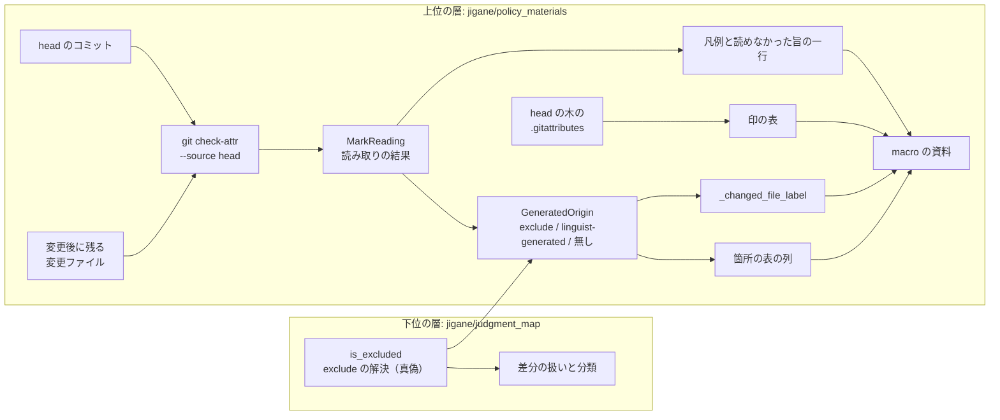
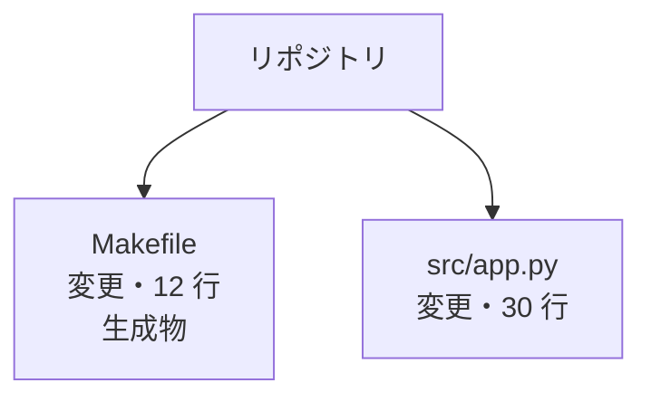

# 生成物の印を方針のレビューの資料に載せる設計

## 要旨

範囲のレビューの方針の群（macro）は、`entrypoints.toml` から `make generate` で作った Makefile と justfile を、同じ手順を三か所に書き写した重複として繰り返し指摘した。macro には、ファイルの本文を渡さない。渡すのは宣言、背景、図と表、前の回の指摘である。ファイル冒頭の注意書きは、資料に届かない。

本書は、リポジトリが `.gitattributes` で `linguist-generated` を付けたファイルを、macro の資料で「生成物」と示す設計を定める。印は `git check-attr --source <head のコミット>` で、レビューする木から読む。ツリー図の札に「生成物」を足し、木に `.gitattributes` の印があれば、そのパターンの表を資料に足して、印の付け方そのものもレビューできるようにする。生成物の出どころは二つに分け、置く層も分ける。`.jigane.toml` の `exclude` の解決は、差分と分類が属する下位の層（`jigane/judgment_map`）に真偽を返す関数として一つ置く。`linguist-generated` の印の読み取りと、出どころの三値の型 `GeneratedOrigin` は、上位の層（`jigane/policy_materials`）だけが持ち、下位の真偽に印を重ねる。印の読み取りの結果は、印あり、印なし、未検査、読めなかった、上限で打ち切った件数を区別する一つの型で返す。「生成物」の札は印だけに付け、`exclude` のファイルには付けない。`exclude` は `*.lock` や vendor のように生成物とは限らないファイルも外すためである。`exclude` は全群から差分を外し、印は差分の扱いを変えず、micro と security の群には、これまでどおり印のファイルの差分を渡す。資料の凡例には、札の意味を一文で足す。公開の引数と保存物の形は増えない。印を読めないときは、読めなかったことを資料に一行書き、印が無いことと区別する。実装計画には、この設計が Makefile と justfile に実際に効くよう、`.gitattributes` の行を足す段を含める。実装は本書の範囲に含めない。

## 1. 序論

### 1.1 問題

macro は、ファイルの属性として種類（判断の箇所の `kind`）と状態（追加、変更など）しか受け取らない。Makefile と justfile の種類は `dependency_build` で、手で書いた依存とビルドの定義と見分けが付かない。macro が本文を読めない以上、生成物かどうかは資料の側で伝えるしかない。

### 1.2 本書の貢献

本書は、生成物の印の出どころ、読む木、読めないときの扱い、資料への載せ方、試験の方針を定める。

## 2. 問題設定と適用範囲

### 2.1 問題定義

レビューする木のどのファイルが生成物かを、macro の資料から読み取れるようにする。印は、リポジトリの持ち主が書いたものを使い、jigane は印を推測しない。印そのものが誤っていないかを、レビューする側が確かめられなければならない。

### 2.2 目標

目標は四つある。`exclude` の解決を下位の層に一つ置き、出どころの型と印の読み取りを上位の層に分けること。印の付いた変更ファイルを、ツリー図で「生成物」と示すこと。`.gitattributes` の `linguist-generated` の行を、macro の資料で読めるようにすること。印を読めなかったことを、印が無いことと取り違えさせないこと。

### 2.3 非目標

生成物の差分を各群から省く挙動（`.jigane.toml` の `exclude`）と、`exclude` のファイルの見せ方（札を付けない）は変えない。micro と security の群は、生成物の差分を受け取る。生成する側（`scripts/generate_entrypoints.py`）に印を出させることも、本書の外とする。`.gitattributes` の行は 5.5 で手書きする。`linguist-generated` 以外の属性（`linguist-vendored` など）と、ファイルの冒頭の注意書きの解釈も扱わない。新しい引数、設定、保存物の項目は足さない。

## 3. 背景

### 3.1 現行の資料の組み方

資料を組むコードの場所は次のとおりである。

| 役割 | 場所 |
| --- | --- |
| ファイルの種類を決める | `jigane/judgment_map/classification.py` の `_classify_file` |
| 資料の節を組む | `jigane/policy_materials/changed_files.py` の `materials_sections` |
| 札の文面を組む | 同ファイルの `_changed_file_label` と `tree_mermaid` |
| 箇所の表を組む | 同ファイルの `regions_text` |
| ファイルの状態と行数を数える | 同ファイルの `file_changes` と、`jigane/figures/models.py` の `FileState` |

`_classify_file` は、`.jigane.toml` の `exclude` に合うファイルを `Kind.GENERATED`（水準は machine）にする。`build_regions` は要判断（required）の区間だけを箇所にするので、生成物は箇所の表に載らない。一方 Makefile と justfile は `COMMON_BUILD_FILE_PATTERNS` に合い、`Kind.DEPENDENCY_BUILD`（required）になって箇所の表に載る。

`exclude` の判定は、`_classify_file` と、差分を作る `jigane/judgment_map/changes.py` の `file_change`（`OMITTED_GENERATED` を返す）が、それぞれ `matches_any(path, config.exclude)` を直接呼んで行う。判定の出どころが二か所に散っている。

ツリー図の札は、`_changed_file_label` が状態と行数だけで組む。種類は札に載らない。したがって、`exclude` に合うファイルもツリー図では普通のファイルと同じに見える。本書はこの見せ方を変えない。

### 3.2 git の起動の入口

jigane は git を `jigane/git/invocation.py` の `git_invocation` だけから起動する。入口は fsmonitor、hook、pager を起動させない指定を引数と環境へ必ず付ける。副コマンドは `jigane/git/command_line.py` の `GitSubcommand` が列挙し、`build_git_invocation` が `--end-of-options` を置いて引数を組む。`scripts/check_egress.py` が、git の呼び出しが入口を通ることを機械的に確かめる。

### 3.3 属性の仕組みと git の版

`git check-attr` は、パスごとに属性の状態を返す。状態は **set**（`linguist-generated` と書いた）、**unset**（`-linguist-generated` と書いた）、**unspecified**（定義が無い）、値（`linguist-generated=false` のように代入した）の四つである。`--source <tree-ish>` を渡すと、その木の `.gitattributes` を読む。`-z` と `--stdin` を併せると、パスを NUL 区切りで標準入力から渡し、結果も NUL 区切りで受け取れる（文書は [1]）。`--source` が入った版は、リリースノートの記述（「`git check-attr` が `.gitattributes` を読む tree-ish を取れるようになった」）から git 2.40 とする [2]。文書の頁自体は版を述べない。

GitHub Linguist は、`.gitattributes` の `linguist-generated` を、生成物を示す印として定める。印を付けたファイルは言語の統計から外れ、GitHub の差分で畳まれる [3]。

## 4. 提案設計

### 4.1 設計概観

レビューが head のコミットと変更前の木（`review.base_tree_path`）を持つとき、資料を組む前に、変更後の木に残る変更ファイルの印を一度だけ読む。印の読み取りは上位の層（`policy_materials`）が行い、下位の層（`judgment_map`）の `exclude` の真偽に重ねる。読み取りの結果は 4.2 の型 `MarkReading` で一つに受け、ツリー図の札、凡例の一行、`.gitattributes` の印の表がそこから引く。



依存の向きは上位から下位だけである。下位の層は印も出どころの三値も知らない。差分の扱いと分類は `exclude` だけから決まり、印の有無で結果が変わらない。micro と security の群は、`exclude` に合わない `linguist-generated` のファイルの差分を受け取り続ける。

### 4.2 生成物の出どころと層

出どころは三つの値を取る。`exclude`（`.jigane.toml` の `exclude` に合う）、`linguist-generated`（head の木で check-attr が set を返す）、無し（手書きと見なす）である。型は `GeneratedOrigin`（`StrEnum`）で、上位の層に一つだけ置く。下位の層が作る値は `exclude` に合うかどうかの真偽だけであり、印の語を知らない。

層ごとの責務は次のとおりである。

| 層 | 置く物 | 責務 |
| --- | --- | --- |
| 下位（`jigane/judgment_map`） | `is_excluded(path, config)` | `exclude` を解決し、合うかどうかの真偽を返す。`Config` の隣（`configuration.py`）に置き、`_classify_file` と `file_change` の直接の `matches_any(path, config.exclude)` をこれに替える |
| 上位（`jigane/policy_materials`） | `GeneratedOrigin`、`MarkReading`、印の読み取りと重ね合わせ | 4.5 の読み取りを `MarkReading` で返し、下位の真偽が偽で印ありのファイルを `linguist-generated` にする。両方に合うファイルは `exclude` にする |

下位の層に印も三値の型も持ち込まない。印は git を起動して head の木から読む資料の層の情報であり、分類と差分は git の属性に依らず `.jigane.toml` だけで決まるためである。

印の読み取りの結果は、上位の層の型 `MarkReading` が一つで表す。次の二つの形のどちらかである。

| 形 | 持つ物 | 意味 |
| --- | --- | --- |
| 読めた | ファイルごとの `MarkState`（`MARKED`、`UNMARKED`、`UNCHECKED`）、上限で検査しなかった件数 | `MARKED` は check-attr が set を返した。`UNMARKED` は検査して set でなかった。`UNCHECKED` は上限を超えて検査していない |
| 読めなかった | 無し | git の失敗か、出力の割れ。どのファイルの印も分からない |

`UNMARKED` と `UNCHECKED` と「読めなかった」を別の値にするので、読めなかったことが「印なし」に潰れない。札は `MARKED` だけに付く。凡例の一行は、読めた形に `MARKED` が一件でもあるときに出る。印の節の「読めなかった」一行は、読めなかった形のときだけ出る。上限を超えた件数の一行は、読めた形の件数が 1 以上のときに出る。三つとも `MarkReading` だけから引くので、引く側が git の結果を別に持たない。

二つの出どころは意味が違う。`exclude` は生成物とは限らないファイル（`*.lock`、vendor、`*.min.js`）も外す。`linguist-generated` はリポジトリの持ち主が生成物と宣言した印である。そのため「生成物」の札と箇所の表の列は `MARKED` だけを根拠にし、`exclude` のファイルには付けない。引く側ごとの扱いを次の表で固定する。

| 引く側 | 層 | `exclude` | `linguist-generated` |
| --- | --- | --- | --- |
| 差分の扱い | 下位 | 全群の差分から外す（`OMITTED_GENERATED`） | 外さない。micro と security の群は差分を受け取る |
| 分類 | 下位 | `Kind.GENERATED`（machine の水準） | 変えない。種類は `dependency_build` などのまま |
| ツリー図の札 | 上位 | 付けない（これまでどおり） | 「生成物」 |
| 箇所の表 | 上位 | 載らない（machine の水準） | 載る。「生成物」の列に `linguist-generated` と書く |

### 4.3 起動の入口

`GitSubcommand` に `CHECK_ATTR = "check-attr"` を足す。`build_git_invocation` は `git_invocation` を通すので、fsmonitor と hook を塞ぐ指定が同じく効く。`scripts/check_egress.py` の入口の検査は、`build_git_command` と `build_git_invocation` の呼び出しを入口として数えるので（`GIT_ARGV_BUILDERS`）、新しい副コマンドもそのまま数える。`build_git_command` は、同じ引数の並びで argv だけを返す関数である。

引数は次の並びにする。

```text
git <入口の -c ...> --no-pager check-attr --source <head の SHA> -z --stdin --end-of-options linguist-generated
```

パスは引数に載せず、NUL 区切りで標準入力へ渡す。引数の長さの上限に当たらず、`-` で始まるパスがオプションにならない。属性の名前は `--end-of-options` の後ろに置く。この並びは git 2.54.0 で実測し、`Makefile|linguist-generated|set|` が返ることを確かめた。`build_git_invocation` は固定の値を FETCH にしか許さないので、CHECK_ATTR にも許す形へ直す。`--source` の値は検査済みの `CommitSha` だけを渡す。ブランチ名や相対参照は渡さない。

`diff` 系の `--no-ext-diff --no-textconv` は要らない。check-attr は属性の状態を返すだけで、textconv と外部の diff を起動しない。filter も起動しない。`--source` を渡すとコミットの木だけを読み、作業木のファイルを読み直さないためである。

### 4.4 読む木

読む木は head のコミットの木とする。範囲のレビュー（`<base>..<head>`）の変更後の木にあたり、ツリー図の変更ファイルの状態が指す側と一致する。作業木と index は読まない。作業木を読むと、レビューする木と手元の木が食い違ったときに、レビューしていない内容が印を決める。

実測で確かめた点がある。head のコミットにだけ `.gitattributes` があり、作業木から消してあっても、`--source` を渡した check-attr はコミットの印を返した。一方 `.git/info/attributes` は `--source` を渡しても効く。リポジトリの手元の設定が、head の木に無い印を足しうる。この経路は PR の作者が書けない。ただし、札が head の木の内容だけを表すとは限らないので、限界として 8.2 に書く。

head か変更前の木を持たないレビューは、本書の対象外とし、札も表も変えない。

### 4.5 印と見なす状態と、読めないときの扱い

check-attr の結果と、印を読めない場合の扱いを次の表で固定する。

| 場合 | check-attr の出力 | 扱い |
| --- | --- | --- |
| 印がある | `set` | `MARKED`（出どころは `linguist-generated`）にする。札に「生成物」を、箇所の表の列に `linguist-generated` を足す |
| 打ち消してある | `unset`（`-linguist-generated`） | `UNMARKED`。札は足さない |
| 定義が無い | `unspecified` | `UNMARKED`。札は足さない |
| 値を代入している | 値の文字列（`=false` は `false` を返すと実測した） | `UNMARKED`。Linguist の文書は値の形を述べず [3]、`set` だけを印とする |
| `.gitattributes` が head の木に無い | 全て `unspecified` | 札を足さず、印の節も出さない |
| git が非 0 で終わる（git 2.40 未満の `--source` 未対応を含む） | 結果なし | `MarkReading` を読めなかった形にする。札を足さず、印の節に「生成物の印を読めなかった。札が無いことは生成物でないことを意味しない」と一行書く |
| 出力が NUL 区切りの三つ組に割れない | 結果なし | 前の行と同じ |
| `.gitattributes` が 1 MB（`jigane/git/tree_files.py` の `MAX_REVIEW_FILE_BYTES`）を超える | 印は読めるが表は出せない | 札は足す。表は出さず「`.gitattributes` が大きすぎて表に載せない」と一行書く |
| 検査するパスが 2000 件を超える | 先頭の 2000 件だけ検査 | 超えた分は `UNCHECKED` にして札を足さず、印の節に件数を書く。「札が無い」が「印が無い」と読めないよう、件数の一行は `UNMARKED` と分けて出す |

読めない場合を空の結果と同じに扱うと、macro は「印が無いので手書きのファイルだ」と読む。この取り違えを避けるため、失敗は資料に残す。git の失敗の文面は資料に載せない。

### 4.6 資料への載せ方

載せる場所は四つである。

一つ目は、ツリー図の札である。`_changed_file_label` が受け取る出どころ（`GeneratedOrigin`）が `linguist-generated` のとき、札の末尾に `<br/>生成物` を足す。`exclude` のファイルと、出どころが無しのファイルには足さない。例は次のとおりである。



札の語は一つで、札に説明文は足さない。一枚の図を画面とプロンプトが同じものとして使うので、画面にも出る。札の意味は、次の凡例で資料に書く。

二つ目は、箇所の表の「生成物」の列である。`regions_text` の「種類」の次に足し、出どころが `linguist-generated` の箇所に `linguist-generated` と書く。他の箇所は空欄にする。この列がないと、Makefile が札で「生成物」、箇所の表で `dependency_build`（要判断）と食い違って見える。列は、`linguist-generated` の箇所が一つでもあるときだけ足し、無ければ表の形は変わらない。`exclude` のファイルは箇所の表に載らないので、列にも出ない。

三つ目は、資料の凡例（図の説明）である。`MarkReading` に `MARKED` が一件でもあるときだけ、図の説明に次の一文を足す。

```text
「生成物」は、宣言から機械で生成したファイルで、手で書き写した重複ではない。直すなら生成元を直す。
```

macro のプロンプトの原則の文は変えない。判断の手がかりは、プロンプトでなく資料で渡す。札が無い木では凡例も出さず、資料の大きさは増えない。

四つ目は、`.gitattributes` の印の表である。head の木にある全ての `.gitattributes`（根と下位のディレクトリ）から、`linguist-generated`、`-linguist-generated`、`linguist-generated=<値>` のいずれかを含む行だけを取り、次の列で並べる。

| 列 | 内容 |
| --- | --- |
| ファイル | その行を持つ `.gitattributes` のパス |
| パターン | 行の先頭のパターン |
| 印 | `linguist-generated`、`-linguist-generated`、`linguist-generated=<値>` のどれか |

表は 30 行までとし、超えた分は件数だけを書く。パターンは 160 文字までに切る。マクロ属性（`[attr]` で定義した別名）は辿らない。そのため、マクロを使う行（`* generated` など）による印は、check-attr が解決するので札と箇所の表の列には出るが、この表には出ない。マクロの定義の行は `linguist-generated` を含むので、この表に載る。資料の読み手は、表の行と札が一対一でないことがありうる、札が最終の結果である、と読む。head の木に `.gitattributes` が無い、または印の行が無いときは、節ごと出さない。この節が、印の付け方そのものをレビューできるようにする。たとえば PR が `* linguist-generated` を足していれば、この表に現れる。

印の行を読む手段は、`git cat-file blob <head>:<パス>` を既存の CAT_FILE の入口から呼ぶ形にする。`.gitattributes` の一覧は `git ls-tree -r --name-only <head>` の結果から、名前が `.gitattributes` のものを選ぶ。どちらも既存の副コマンドで、新しい入口は CHECK_ATTR だけである。

### 4.7 資料の大きさへの影響

印を持つファイルが無い木では、札も節も変わらず、資料の大きさは増えない。印を持つファイルがあるときの増分は、札一枚につき約 8 文字と、凡例の一文（約 50 文字）、箇所の表の列、`.gitattributes` の表の最大 30 行である。表の最大は、1 行を 160 文字で切るので、約 5 KB に収まる。実測は実装で取る。

### 4.8 横断的関心事

レビューする木の内容が、jigane の起動するコマンドを変えてはならない。check-attr は入口を通すので、fsmonitor と hook の抑止が効く。パスは標準入力に載せ、`--source` の値は検査済みの `CommitSha` に限るので、PR の作者が起動の引数を作れない。`.gitattributes` の内容は、属性の状態の判定以外に使わず、表にはパターンの文字列を載せるだけである。外へ出る通信は無い。

`.gitattributes` は PR の作者が書くので、印は信用できる事実ではなく、レビュー対象の一部である。誤った印は、macro に重複の指摘を見送らせうる。表を載せるのは、この攻撃面をレビューする側が見られるようにするためである。micro と security の群は生成物の差分を受け取り続けるため、印の誤りで差分が隠れることもない。

## 5. 実装計画

実装は五段に分ける。

| 段 | 内容 | 検査 |
| --- | --- | --- |
| 5.1 入口 | `GitSubcommand.CHECK_ATTR` を足し、`build_git_invocation` が CHECK_ATTR の固定の値を許す。 | 入口の試験と `check_egress.py` |
| 5.2 下位の層の一本化 | `jigane/judgment_map` に真偽を返す `is_excluded` を新設し、`_classify_file` と `file_change` の `exclude` の判定をこれに替える。結果は変えない。 | 既存の分類と差分の試験が変わらず通る |
| 5.3 読み取り | head の SHA と変更ファイルから、印の付いたパスを読み、`MarkReading`（4.2）を返す関数と、下位の `is_excluded` に重ねた変更ファイルごとの `GeneratedOrigin` を返す関数を `policy_materials` に置く。失敗と上限の扱いは 4.5 の表に従う。 | 読み取りの試験。読めなかった形、`UNMARKED`、`UNCHECKED` が互いに区別できることを含む |
| 5.4 資料 | 札に「生成物」を足し、凡例の一文、箇所の表の列、`.gitattributes` の印の節を組んで `materials_sections` に加える。 | 資料の試験 |
| 5.5 印の付与 | 生成物に `linguist-generated` を付ける `.gitattributes` の行を足す。下に書く。 | 5.4 の資料で、該当ファイルの札が出る |

縦切りは 5.1 から 5.4 を通す最小の木（Makefile に印を付けた一件）で先に通す。一件の目安は 5 ファイル、300 行以下であり、超えるときは段ごとに分ける。

5.5 がないと、本書の動機である Makefile と justfile の取り違えは、実装が済んでも解消しない。印を付ける対象は、ファイル全体を生成するものに限る。`linguist-generated` はファイル単位の属性なので、印の間だけを書き換えるファイルには付けられない。生成物は `scripts/` の生成器と、「生成物なので直接直さない」などの注意書きを grep で探して列挙した。

| 側 | 印を付けるファイル | 生成する側 |
| --- | --- | --- |
| CLI の側 | `Makefile`、`justfile` | `scripts/generate_entrypoints.py`（`entrypoints.toml` から生成） |
| CLI の側 | `jigane/languages/grammar-hashes.json` | `scripts/generate_grammar_hashes.py` |
| GUI の側 | `Makefile`、`justfile` | `scripts/generate_entrypoints.py`（`entrypoints.toml` から生成） |

CLI の側は、根に `.gitattributes` を新設し、`/Makefile linguist-generated`、`/justfile linguist-generated`、`/jigane/languages/grammar-hashes.json linguist-generated` の三行を書く。GUI の側は、本書の作業では読むだけにとどめる。同じ形の `/Makefile linguist-generated` と `/justfile linguist-generated` の二行を、GUI の側の別の件として land する。

印を付けないファイルもある。印の間だけを生成器が書くファイルで、CLI の側は `README.md`、`SECURITY.md`、`pyproject.toml`、`jigane/README.md`、各サブパッケージの `README.md`、GUI の側は `entrypoints.toml`（`scripts/entrance_tasks.py` が書く範囲）である。`uv.lock` などの `*.lock` は、`exclude` の既定の並びが既に生成物として扱う。GUI の側の `gui/jigane_gui/static/vendor/mermaid.min.js` は、`*.min.js` と `vendor/*` の `exclude` に合う。GUI の側の列挙は grep の範囲で、漏れがないことは確かめていない。

## 6. 代替案の検討

| 案 | 捨てた理由 |
| --- | --- |
| ファイルの冒頭の注意書き（Go の `Code generated ... DO NOT EDIT.`）を読む | 規約は Go のもので、Makefile と justfile に効かない。生成する側に行を出させる改修も別に要る。`.gitattributes` はリポジトリが言語によらず宣言でき、GitHub の画面とも一致する |
| `.jigane.toml` の `exclude` に Makefile と justfile を足す | コードの変更は要らない。ただし差分が全群から消え、micro と security も生成物の食い違いを見られなくなる。札も変わらない |
| `.gitattributes` を jigane が自分で解釈する | パターンの規則、優先順位、ディレクトリごとの上書き、マクロ属性を実装し直すことになる。`git check-attr` は git 本体の規則と一致する |
| 作業木から属性を読む（`--source` を付けない） | レビューしていない作業木の内容が印を決める。head の木と食い違ったとき、図の内容と資料の内容が別の木になる |
| 札に「生成物」を載せず、Makefile の本文を macro に渡す | 本文を渡さない macro の設計に反し、入力が増える |
| 札だけにして表を載せない | 印の付け方を macro がレビューできない。`* linguist-generated` のような広い印を、他の変更と同じ目で見られない |

## 7. 検証方法

- 一時のリポジトリで、Makefile に印、justfile に `=false`、`sub/**` に `-linguist-generated` を付けたコミットを作り、札が Makefile だけに付くことを試験する。
- head の木の `.gitattributes` を作業木で消しても、head の印で札が付くことを試験する。
- `.gitattributes` が無い木で、札も印の節も出ないことを試験する。
- check-attr が失敗したとき（`--source` を解釈できない git の代わりに、存在しない SHA を渡す）、`MarkReading` が読めなかった形になり、札が付かず、印の節に読めなかった旨の一行だけが出ることを試験する。2000 件を超える入力で、超えた分が `UNCHECKED` になり、`UNMARKED` と混ざらないことも試験する。
- 印の行が 31 行以上のときの件数表示と、160 文字を超えるパターンの切り詰めを試験する。
- 属性の出どころごとの扱い（4.2 の表）を試験する。`exclude` のファイルは差分が外れて札も列も付かず、`linguist-generated` のファイルは差分が渡って札と箇所の表の列が付く。両方に合うファイルは `exclude` になり、札が付かない。下位の層の分類と差分は、印の有無で結果が変わらない。
- マクロ属性（`[attr] generated linguist-generated` と `* generated`）で印が付くファイルに、札と箇所の表の列が出て、使う側の行（`* generated`）が `.gitattributes` の印の表に出ず、定義の行だけが出ることを試験する。
- `linguist-generated` の箇所が無いとき、箇所の表の列が出ず、表の形が変わらないことを試験する。
- 札が一枚でもあるとき、凡例の一文が資料に出る。札が無いとき、出ない。
- ツリー図と印の節の Mermaid が、`mmdc` で描画できる。
- `scripts/check_egress.py` が新しい呼び出しを入口経由と数え、`make check` が緑である。

## 8. リスクと限界

### 8.1 リスクと緩和

check-attr の出力の形式が将来の git で変わるリスクがある。`-z` の三つ組の形式は文書に定められており [1]、割れない出力は 4.5 の表のとおり読めなかった扱いにする。試験は実際の git を起動して形を確かめる。

git 2.40 未満では `--source` を解釈できない。この場合は 4.5 の表のとおり、読めなかったことを資料に残す。必要な版の下限は文書では確かめきれていない（3.3）ので、実装時に 2.40 の実機で確かめる。

### 8.2 既知の限界

`.git/info/attributes` や `core.attributesFile` の設定は、`--source` を渡しても印に効く。リポジトリや利用者の手元の設定なので、レビューする木の内容を表す札にならない場合がある。これを塞ぐ手段は `-c` にあるか、本書は確かめていない。受容する理由は、この経路を書けるのが手元の設定の持ち主に限られ、PR の作者でないことである。

マクロ属性、`.gitattributes` の優先順位による上書きの全体は、表に載せない。表は印を持つ行の列挙で、最終の結果は札が示す。`.gitattributes` が 100 MB を超えるときや、シンボリックリンクのときの git の扱いは、確かめていない。

head を持たないレビュー（設計書のレビューなど）には、印を載せない。

LLM の出力は揺れる。凡例を足しても、macro が重複の指摘を止めるとは保証できない。重複の指摘が止むことは、機械の完了の条件にしない。

## 9. 今後の課題

実装を land した後、印を付けた Makefile と justfile を含む範囲を一度レビューし、macro が重複の指摘を出すかを観察して記録する。範囲は、5.5 の変更を含む枝の前後を取る。観察は一回で、結論の根拠にしない。重複の指摘が残るなら、凡例の文面と、資料に渡す手がかりの足りない点を調べる。

生成器が `.gitattributes` の行を出す、または生成物の一覧と `.gitattributes` の食い違いを機械的に検査する。5.5 の行は手書きなので、新しい生成物を足したときに行を足し忘れうる。この改修は本書の外にある。

## 10. 参考文献

1. Git, "git-check-attr Documentation." `https://git-scm.com/docs/git-check-attr`。`--source`、`-z`、`--stdin`、`--cached` と、set、unset、unspecified、値の四つの状態を定める。既定で読む木と、`--source` が入った版は、この頁に書かれていない。
2. Git, "Release Notes 2.40." `https://raw.githubusercontent.com/git/git/master/Documentation/RelNotes/2.40.0.adoc`。「`git check-attr` が `.gitattributes` を読む tree-ish を取れるようになった」の記述がある。フラグ名は書かれていない。
3. GitHub Linguist, "Overrides." `https://github.com/github-linguist/linguist/blob/main/docs/overrides.md`。`.gitattributes` の `linguist-generated` で生成物を示し、統計から外し、差分で畳む。`=false` の形と打ち消しの例は、この頁に書かれていない。
