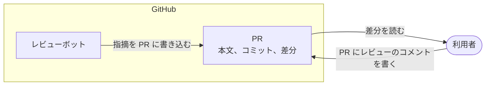
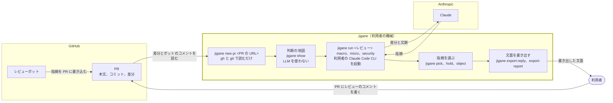
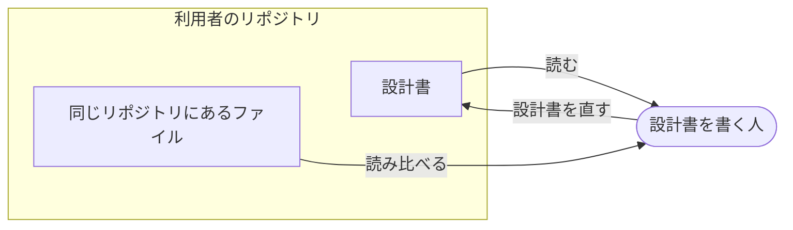
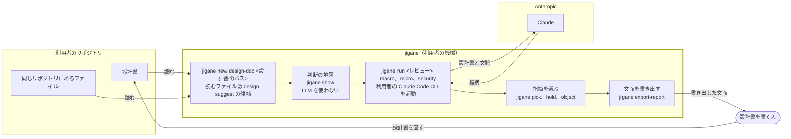

# 想定する使い方

[README に戻る](../README.md)

jigane は、利用者の手元の機械で動きます。想定する使い方は、GitHub の PR のレビューと、設計書のレビューの二つです。どちらも、jigane が出した指摘から利用者が選び、文面を書き出すところまでを受け持ちます。PR へのコメントと設計書の直しは利用者が行い、jigane は GitHub へ書き込みません。

## GitHub の PR のレビュー

PR の情報とコードの変更差分の二つを、方針、実装、セキュリティの三つの群でレビューします。PR の情報は gh で読み、レビューボットが行に付けたコメントも取得します。コードの変更差分はリポジトリを複製して差分を git で取り出します。

方針、実装、セキュリティの三つのレビューについては、「[方針、実装、セキュリティのレビュー](reviews.md#方針実装セキュリティのレビュー)」の節を参照してください。

通常の PR のレビューでは、利用者が GitHub 上でコードの差分を読み、どこに判断が要るかを自分で探してコメントを書きます。レビューボットを使うときは、ボットが指摘を PR へ直接書き込みます。

jigane を利用すると、利用者の機械で判断の地図を作り、利用者の Claude Code を通じて指摘を得て、利用者が選んだ指摘を利用者が PR に書きます。通常の PR のレビューとの違いは次の三つです。

- 差分を読む前に、判断の地図が差分のどこに人の判断が要るかを示します。
- jigane の指摘は PR に書き込まれず、利用者の機械に残ります。利用者が指摘を選び、文面を書き出してから PR に書きます。
- レビューボットのコメントは jigane が読み、変更がその指摘に対応しているかを方針の群で問います。

## 設計書のレビュー

設計書と、同じリポジトリにあるファイルの二つを、方針、実装、セキュリティの三つの群でレビューします。設計書は、jigane を呼んだ場所の git のリポジトリの中に置きます。同じリポジトリにあるファイルは、既定では `jigane design suggest` の候補すべてを読み、`--select` で選び直せます。検証メモなどの付属の文書は、`--with` で付けたときだけ読みます。

方針、実装、セキュリティの三つのレビューについては、「[方針、実装、セキュリティのレビュー](reviews.md#方針実装セキュリティのレビュー)」の節を参照してください。

通常の設計書のレビューでは、設計書を書く人が、設計書と同じリポジトリにあるファイルを読み比べ、どこに判断が要るかを自分で探して設計書を直します。

jigane を利用すると、利用者の機械で判断の地図を作り、利用者の Claude Code を通じて指摘を得て、設計書を書く人が選んだ指摘をもとに設計書を直します。通常の設計書のレビューとの違いは次の三つです。

- 読み比べるファイルの候補を、`jigane design suggest` が設計書の名指しから挙げます。
- 読む前に、判断の地図がどこに人の判断が要るかを示します。
- jigane の指摘は設計書に書き込まれず、利用者の機械に残ります。設計書を書く人が指摘を選び、文面を書き出してから設計書を直します。

データがどこへ送られるかは「[データの送り先と利用の条件](../README.md#データの送り先と利用の条件)」の節に、gh で呼ぶコマンドは「[jigane が呼ぶ gh のコマンド](data-destinations.md#jigane-が呼ぶ-gh-のコマンド)」の節にまとめています。
