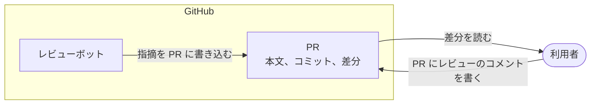
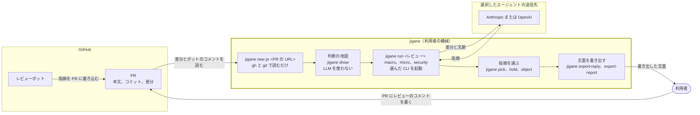
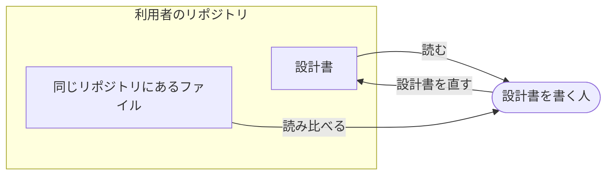
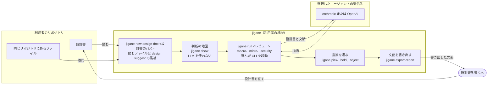

# 想定する使い方

[README に戻る](../README.md)

jigane は、利用者の手元の機械で動きます。想定する使い方は、GitHub の PR のレビューと、設計書のレビューの二つです。どちらも、jigane が出した指摘から利用者が選び、文面を書き出すところまでを受け持ちます。PR へのコメントと設計書の直しは利用者が行い、jigane は GitHub へ書き込みません。

## GitHub の PR のレビュー

PR の情報とコードの変更差分の二つを、方針、実装、セキュリティの三つの群でレビューします。PR の情報は gh で読み、レビューボットが行に付けたコメントも取得します。コードの変更差分はリポジトリを複製して差分を git で取り出します。

方針、実装、セキュリティの三つのレビューについては、「[方針、実装、セキュリティのレビュー](reviews.md#方針実装セキュリティのレビュー)」の節を参照してください。

通常の PR のレビューでは、利用者が GitHub 上でコードの差分を読み、どこに判断が要るかを自分で探してコメントを書きます。レビューボットを使うときは、ボットが指摘を PR へ直接書き込みます。

jigane を利用すると、利用者の機械で判断の地図を作り、選んだエージェント（Claude Code または Codex）で指摘を得て、利用者が選んだ指摘を利用者が PR に書きます。通常の PR のレビューとの違いは次の三つです。

- 差分を読む前に、判断の地図が差分のどこに人の判断が要るかを示します。
- jigane の指摘は PR に書き込まれず、利用者の機械に残ります。利用者が指摘を選び、文面を書き出してから PR に書きます。
- レビューボットのコメントは jigane が読み、変更がその指摘に対応しているかを方針の群で問います。

## 設計書のレビュー

設計書と、同じリポジトリにあるファイルの二つを、方針、実装、セキュリティの三つの群でレビューします。設計書は、jigane を呼んだ場所の git のリポジトリの中に置きます。同じリポジトリにあるファイルは、既定では `jigane design suggest` の候補すべてを読み、`--select` で選び直せます。検証メモなどの付属の文書は、`--with` で付けたときだけ読みます。

方針、実装、セキュリティの三つのレビューについては、「[方針、実装、セキュリティのレビュー](reviews.md#方針実装セキュリティのレビュー)」の節を参照してください。

通常の設計書のレビューでは、設計書を書く人が、設計書と同じリポジトリにあるファイルを読み比べ、どこに判断が要るかを自分で探して設計書を直します。

jigane を利用すると、利用者の機械で判断の地図を作り、選んだエージェント（Claude Code または Codex）で指摘を得て、設計書を書く人が選んだ指摘をもとに設計書を直します。通常の設計書のレビューとの違いは次の三つです。

- 読み比べるファイルの候補を、`jigane design suggest` が設計書の名指しから挙げます。
- 読む前に、判断の地図がどこに人の判断が要るかを示します。
- jigane の指摘は設計書に書き込まれず、利用者の機械に残ります。設計書を書く人が指摘を選び、文面を書き出してから設計書を直します。

データがどこへ送られるかは「[データの送り先と利用の条件](../README.md#データの送り先と利用の条件)」の節に、gh で呼ぶコマンドは「[jigane が呼ぶ gh のコマンド](data-destinations.md#jigane-が呼ぶ-gh-のコマンド)」の節にまとめています。

## レビュー設定の違い

| 操作 | Claude Code | Codex |
| --- | --- | --- |
| 担当モデルと推論量を選ぶ | `run` の `--model` と `--effort` で変更できます | レビューの役割や設計原則に応じて jigane が選びます。手動変更には対応していません |
| 1回のモデル起動に予算を指定する | `run --max-budget-usd-per-call` で指定できます | この指定には対応していません |
| 確認入力を省いて1群を実行する | `debug run --yes --max-usd` で群の見積もりと指定額を照合します | 同じコマンドを使います。指定額は1群につき 1 USD までです |
| セキュリティレビューで MCP を使う | `run` と `debug run` で `--mcps` を指定できます。Claude Code が設定を開いて接続します | 端末の `run` で、登録した stdio サーバの資料を参照できます |
| `usage` で費用を確認する | Claude Code CLI が報告した USD 額を表示します | Codex CLI が報告した使用量をモデル単価で USD に換算して表示します |

`debug run` の `--max-usd` は、実行を始めるかどうかの判定に使います。実行後の額は指定額を超えることがあります。

## セットアップの詳細

作業ツリーから使うときは、`make setup`（Windows は `just setup`）の最初に選択します。保存済みの選択は維持します。未選択なら `JIGANE_AGENT=claude` または `JIGANE_AGENT=codex` で指定でき、指定が無く PATH 上の対応エージェントが一種類なら自動で選びます。候補が一意に決まらない場合は端末で質問し、CI などの非対話環境では依存のセットアップを続けて後から選択できます。セットアップが導入するのは jigane の依存と文法です。

Claude Code を選ぶと、jigane は起動前に `claude --version` を確認し、2.1.308 より古い場合や版を読み取れない場合は停止します。Windows の npm 版 `claude.cmd` は JSON 引数を安全に渡せないため、公式インストーラで `claude.exe` を導入します。[Windows の導入手順](https://code.claude.com/docs/en/setup#install-on-native-windows)

Codex の対応 OS は macOS と Linux です。macOS で動作を確認した版は `0.171.0-alpha.13` です。端末とデスクトップ版のどちらから起動しても、Codex CLI に保存した ChatGPT ログインを使います。

`jigane languages fetch python swift` のように言語を指定すると、その文法だけを取得します。非対話環境では、利用規約とプライバシーポリシーを確認して `jigane languages fetch --accept-terms` を実行します。[取得時の同意と文法の照合](data-destinations.md#文法の取得)

新しい版で作ったファイルを古い版で読み込むと、jigane は停止して更新を案内します。`uv tool upgrade jigane` または `pipx upgrade jigane` で更新してください。

## 名前の由来

地鉄は、日本刀の刀身の鋼の肌を指します。鑑賞と鑑定では、作られた時代や流派を見極める見どころとされます。
