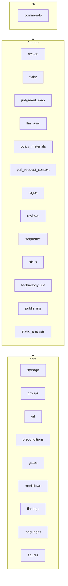

# jigane

PR または作業ツリーの変更を受け取り、レビューの材料（判断の地図、背景、ボットの指摘）を決定的に集めて保存します。スキルの実行で LLM に指摘を作らせ、選んだ指摘から返信とレポートを書き出します。

保存の置き場所はデータホスト直下のレビューごとのディレクトリで、その読み書きは `storage` と `reviews` が受け持ちます。

## サブパッケージ

`jigane/` の直下は、サブパッケージと、直下に残る三つのモジュールからなります。

<!-- BEGIN GENERATED: package-table (scripts/generate_package_readme.py) -->

| サブパッケージ | 役割 |
| --- | --- |
| [`commands`](commands/README.md) | 副コマンドの入口と、表示の行の組み立てを受け持ちます。 |
| [`design`](design/README.md) | 設計書（Markdown）を、見出しの木、Mermaid の図、表に分けます。 |
| [`figures`](figures/README.md) | 方針の図（表、Mermaid、ツリー、シーケンス図）の構造の型を持ちます。 |
| [`findings`](findings/README.md) | 指摘の保存と選別の記録、捨てた理由を受け持ちます。 |
| [`flaky`](flaky/README.md) | テストのファイルから、不安定になりやすい書き方（flaky の型）を静的に探します。 |
| [`gates`](gates/README.md) | ゲートの違反と警告の一件の型、その説明の文、検出の対象の行の範囲を持ちます。 |
| [`git`](git/README.md) | 外部コマンドの起動と、git の木の読み出しを受け持ちます。 |
| [`groups`](groups/README.md) | 群（方針、実装、セキュリティ）の識別子、表示名、既定を持ちます。 |
| [`judgment_map`](judgment_map/README.md) | 判断の地図、変更の宣言、変更の種類、`.jigane.toml` の規則を受け持ちます。 |
| [`languages`](languages/README.md) | ソースファイルを tree-sitter で構文木にし、言語ごとの違いを `LanguageAdapter` の裏に閉じ込めます。 |
| [`llm_runs`](llm_runs/README.md) | LLM の起動、実行の記録、見積もりと使用量、使った額を受け持ちます。 |
| [`markdown`](markdown/README.md) | Markdown の柵と見出しの判別、表のセルの整形を受け持ちます。 |
| [`policy_materials`](policy_materials/README.md) | 方針の群に渡す資料（図と表）を組みます。 |
| [`preconditions`](preconditions/README.md) | 呼び出し側が保証している前提を確かめ、型を絞ります。 |
| [`publishing`](publishing/README.md) | 返信とレポートの描画を受け持ちます。 |
| [`pull_request_context`](pull_request_context/README.md) | PR の取得、変更の背景、レビューボットの指摘を受け持ちます。 |
| [`regex`](regex/README.md) | 変更した正規表現を、LLM を使わずに数えて札にします。 |
| [`reviews`](reviews/README.md) | レビューの組み立て、保存、読み込み、更新、選別、付属の文書を受け持ちます。 |
| [`sequence`](sequence/README.md) | レビューが変更した宣言から、変更が届く入口（根）ごとのシーケンス図を、LLM を使わずに作ります。 |
| [`skills`](skills/README.md) | LLM に指摘を作らせるスキル群を持ちます。 |
| [`static_analysis`](static_analysis/README.md) | 静的検査の結果（SARIF）を読み、検証して、正規化した指摘にします。 |
| [`storage`](storage/README.md) | データの置き場の読み書き、保存物の形の検査、読み書きの失敗を受け持ちます。 |
| [`technology_list`](technology_list/README.md) | レビューが変更したファイルの import から、使っている技術の表を LLM を使わずに作ります。 |

<!-- END GENERATED: package-table -->

直下に残るモジュールは次の二つです。

| モジュール | 役割 |
| --- | --- |
| `__init__` | パッケージの版（`__version__`）を保持します |
| `__main__` | `python -m jigane` の入口です（`jigane.commands` の `main` を呼びます） |

データファイル用のディレクトリ `templates/`（返信とレポートのテンプレート）は、Python のサブパッケージではありません。

## モジュールの関係

サブパッケージは、下から core、feature、cli の三つの層に分かれます。層の名前は関係を示すための呼び名であり、パッケージの名前にもディレクトリにも入っていません。

<!-- BEGIN GENERATED: layer-diagram (scripts/generate_package_readme.py) -->

<!-- END GENERATED: layer-diagram -->

矢印は「読む」の向きです。`a --> b` は、`a` の層の中のモジュールが `b` の層の中のモジュールを import することを表します。

層の決まりは次のとおりです。上の層は、下の層も同じ層も読んでかまいません。下の層は、上の層を読みません。関数の中の import と、型の注釈だけのための import（`if TYPE_CHECKING:` の中）も、この決まりの対象です。

この決まりは `pyproject.toml` の `[tool.importlinter]` に層の契約として書かれ、`lint-imports`（`make lint` が走らせる）が import の向きを確かめます。図の層の割り当てと契約の層の割り当てが一致することは `tests/test_package_dependency_diagram.py` が確かめます。サブパッケージを足したときは、どれか一つの層に入れてください。上のサブパッケージの表と図は `scripts/generate_package_readme.py` が層の契約と各サブパッケージの README の先頭の一文から作るので、手で直さないでください。各サブパッケージの README の「他のモジュールとの関係」にある、読むサブパッケージと読まれるサブパッケージの名前の一覧も、`scripts/generate_readme_dependencies.py` が grimp で測った実際の import から作るので、手で直さないでください。

同じ層の中の依存は、宣言したものだけを許します。宣言は `pyproject.toml` の `[tool.jigane.allowed_sibling_imports]` にあり、import する側のサブパッケージの行へ、読む兄弟を足します。新しく兄弟を読むときは、その行へ相手を足して `make generate`（Windows は `just generate`）を走らせてください。`[tool.importlinter]` の forbidden の契約は、この表と層の契約から作られます。サブパッケージを足したときも、層の契約に入れて同じ生成を走らせると、上の表と図が作り直されます。

## Q&A

### なぜ保存先のファイルの書き込みと更新の排他に決まった入口があるのですか

保存先のファイルの書き込みは `storage.store.write_text_atomic` を通し、同じレビューへの更新は `storage.store.review_lock` で排他します。一時のファイルへ書いてから置き換えるので途中で落ちても壊れたファイルが残らず、排他がないと並行して実行した二つの群が、読んだ時点の状態へ自分の群だけを足して保存し、後の保存が先の群を消すためです。

### なぜツリーの中のファイルは `git.tree_files` を通して読むのですか

ツリーの中のファイルは `git.tree_files` を通して読み、ツリーの外へ出しません。ツリーは PR 由来で攻撃者が作れるので、シンボリックリンクや木の外への参照を読むとレビューする側のマシンの秘密を読み出す経路になり、その扱いを一か所に集めているためです。

### なぜ外部コマンドの起動は `git.process` を通すのですか

外部コマンドの起動は `git.process` を通します。この入口が、起こす git から `GIT_DIR` などの向き先を狂わせる環境変数を外し、失敗にコマンドと作業ディレクトリを添え、検査で差し替える唯一の場所になっているためです。
