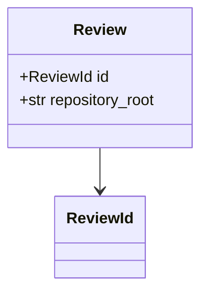
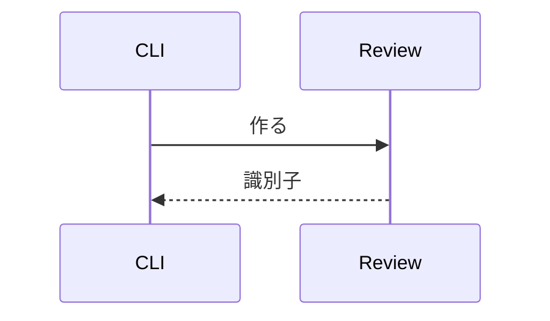

# レビューの保存の見本の設計

テストの素材として書き起こした設計書の見本である。実在の設計の記録ではない。

## 1. 序論

レビューは `Review` として `jigane/reviews/lifecycle.py` が組み立て、データの置き場に保存する。識別子は `ReviewId` で、出所は `ReviewOrigin` の一つを持つ。

## 2. 提案設計

### 2.1 型

| 型 | 置き場 | 役割 |
|---|---|---|
| `Review` | jigane/reviews/lifecycle.py | 保存する一件のレビュー |
| `ReviewId` | jigane/storage/store.py | 置き場の中の名前 |



### 2.2 保存の流れ



```python
# 見出しに見えるが、コードの中の注釈である
review = read_review_at(directory)
```

## 3. 検証方法

`jigane new files` で作り、`jigane show` で読み直す。
